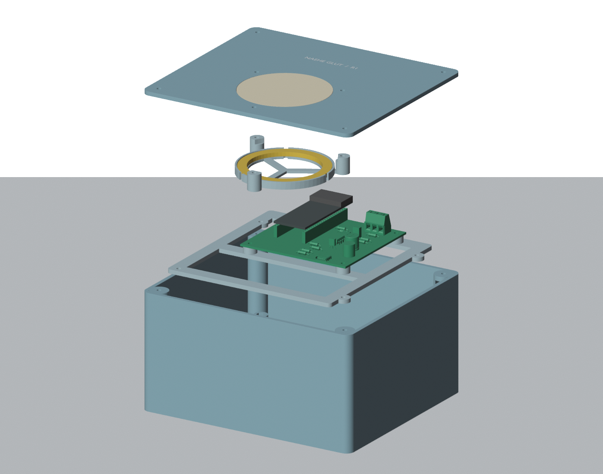

# Nähe Glut R1: Platine, Gehäuse und Beschaffung

Stand: **31. Oktober 2026**. Prototyprevision für zwei ESP32-S3-Stationen.
Digitale Fertigungsunterlagen sind erstellt; der abschließende Freigabestand
und konkrete Prüfgrenzen stehen im [unabhängigen Review](REVIEW.md).
Es wurde noch nichts bestellt, gedruckt, bestückt oder auf Geräte geladen.

## Benutzen

- [PCB-Fertigungspaket als ZIP](pcb/exports/naehe-glut-r1-fertigung.zip)
  und [Druckpaket als ZIP](fertigung/NG-R1-Druckpaket.zip).
- [Bestellliste für beide Geräte](BESTELLUNG.md): Boards, Ringe, Akkus,
  Drucker, Filament, Kabel und Montagebedarf.
- [PCB-Bauteile](pcb/BOM.md) und [Fertigung/elektrische Montage](pcb/FERTIGUNG.md).
- [Gehäusemontage](mechanik/MONTAGE.md) und [Druckprojekte/Prüfweg](mechanik/DRUCK.md).
- Native KiCad-Dateien unter `pcb/`; FCStd, STEP und STL unter `mechanik/`;
  sechs vorbereitete A1-mini-Projekte unter `mechanik/print/`.

## Festgelegter Aufbau

ESP32-S3-DevKitC-1-N16R8 von Espressif, Adafruit-1586-Ring mit **24 Pixeln**,
Voltaic-V50-Akku und zweilagige Carrierplatine, 85×80 mm. GPIO15 führt
LED-Daten, GPIO16 gibt die 5-V-Pufferstufe frei. Der Carrier versorgt keine
ESP-5V-/3V3-Pins; zwei USB-A-Kabel vom Akku speisen getrennte Pluspfade bei
gewollt gemeinsamer Masse. Laden erfolgt mit entnommenem Akku.

Beschaffungsänderung vom 31.10.2026 auf Basis `e9e2afe`: Das lieferbare
Original-N16R8 ersetzt N8R8 mit denselben Carrieranschlüssen. Der Schaltplan
behält die ursprüngliche N8R8-Bezeichnung; mechanische und elektrische
Carrierdateien bleiben unverändert. Die Firmware braucht 16 MB Quad-Flash
und weiterhin 8 MB Octal-PSRAM; eine Geräteprüfung steht aus.

Das PETG-Gehäuse misst 168×148×90 mm ohne Schraubenköpfe. Boden, Träger,
Deckel, Ringhalter und Diffusor sind getrennt druckbar; ein Coupon prüft
vorab Schrauben-/Mutternpassung. Drucker: Bambu Lab A1 mini, 0,4-mm-Düse,
ohne AMS. Vier Nylonbefestiger halten die PCB im Antennenbereich. Schwarze
Teile verwenden nun **Bambu PETG Basic 30105**, der Diffusor weiter PETG
Translucent Clear. Alle sechs Druckprojekte sind neu berechnet; etwa 11,7 Stunden
Maschinenzeit je Station. Beschaffungsquellen und Trocknung stehen in der Bestellliste.

Die Auslegung gilt für trockenen, vor Regen geschützten Einsatz. Eine konkrete
Mindestlaufzeit wurde nicht vorgegeben; die Bestellliste enthält gekennzeichnete
Laufzeitrechnungen. Keine IP-, Wärme- oder Funkfreigabe wird aus CAD/Slicer
abgeleitet. Ein ausgeschalteter ESP löscht gespeicherte Pixelfarben nicht;
für Service beide Versorgungszweige trennen.

## Auftrag, Zuständigkeit und Termin

Quelle: Nutzerauftrag in Codex-Sitzung `01a192e5-6a3d-7ce2-a9e1-bfacd9a97e3b`,
31.10.2026, Basiscommit `63477d08e160d1b1f81b37bbd16593c1a2087624`:
bestellbare PCB und druckbares Gehäuse; Komponentenwahl, Akkukonzept und
Druckerauswahl ausdrücklich delegiert.

Koordination/Maintainer und Beschaffung: `/root`; Elektronik:
`/root/hardware_developer`; Mechanik: `/root/enclosure_developer`;
unabhängige Gegenprüfung Gerätevertrag/Qualität: `/root/hardware_review`.
Beschaffungsnachtrag: `/root` verantwortlich, `/root/filament_supply` setzt
Materialprofile um, `/root/supply_review` prüft unabhängig gegen.
Eigene Umsetzung gilt nicht als unabhängiger Review.

**Zwei funktionierende Exemplare bis Dezember 2026 bleiben das Lieferziel.**
Eine eigene PCB darf diesen Termin nicht gefährden. Die
[kanonische Hardwareplanung](../HARDWAREPLANUNG.md) behält Vorrang; bei
Fertigungsrisiko ist parallel ein Aufbau mit vorhandenen Boards/Modulen
vorzusehen. Das genaue Dezemberdatum ist weiterhin offen.

Diese Dateien liefern die Hardwareentwicklung. Firmwareportierung auf S3/R1,
schwarzer Startframe mit 24 Pixeln, Effekt/Funk zwischen beiden Geräten,
Probemontage, Last-/Wärmeprüfung und Dauerlauf bleiben gesonderte Arbeit.
Die alte ESP32-Box und ihr 23-Pixel-Aufbau werden durch R1 nicht umgebaut.

## Werkzeuge und Nachweise

| Bereich | Werkzeug / Beleg | Aussage |
| --- | --- | --- |
| Elektronik | KiCad 10.0.8; `pcb/pruefung/` | ERC, DRC, Netzlisten-/Layoutabgleich und CAM-Prüfung gemäß Review |
| Geometrie | FreeCAD 1.0.2; `mechanik/geometry-report.json` | Gültige Körper, STEP-Rückimport, geschlossene STL-Netze, Kollisionen und Bezug auf den echten PCB-STEP |
| Druck | Bambu Studio 2.8.2.61; `mechanik/slice-report.json` | Alle sechs Teile erfolgreich berechnet; Datei-Hashes, Material und Zeitabschätzungen |
| Gegenprüfung | `REVIEW.md` | Unabhängige konkrete Befunde, Freigabeumfang und offene physische Nachweise |

Generatoren liegen unter `tools/`. Montage- und Druckanleitungen nennen die
reproduzierbaren Aufrufe. Lokale Werkzeugdownloads, Probeläufe und Sicherungen
unter `.tmp/` sind keine Lieferdateien. PCB-Änderungen erfordern neuen Export
und Geometrieabgleich; Änderungen an Druckteilen erfordern neue Slicerprojekte.

„Bestellbar“ bedeutet geprüftes Prototyp-Fertigungspaket mit eindeutiger
Stückliste, keine gesicherte Lagerverfügbarkeit und keinen ausgelösten Kauf.
„Druckbar“ bedeutet digital geprüfte Druckdateien, keine bestandene physische
Passprobe oder Produktabnahme.

## Abgrenzung bestehender Vorarbeiten

[Issue #112](https://github.com/Sven401/Larp-Escape/issues/112) und
[PR #113](https://github.com/Sven401/Larp-Escape/pull/113) führen das
Vollboxkonzept PCB-K0. DFPlayer, MCP und weitere Vollboxfunktionen werden
daraus nicht als Bauumfang dieser Nähe-Glut-Variante übernommen.
Historische Schaltplanquellen bleiben im [Quelleninventar](../QUELLENINVENTAR.md).
