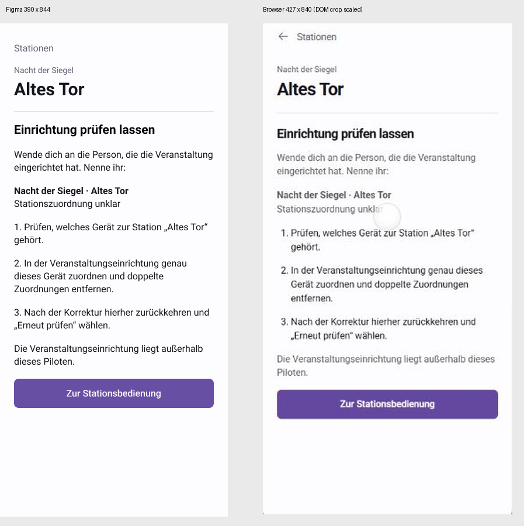
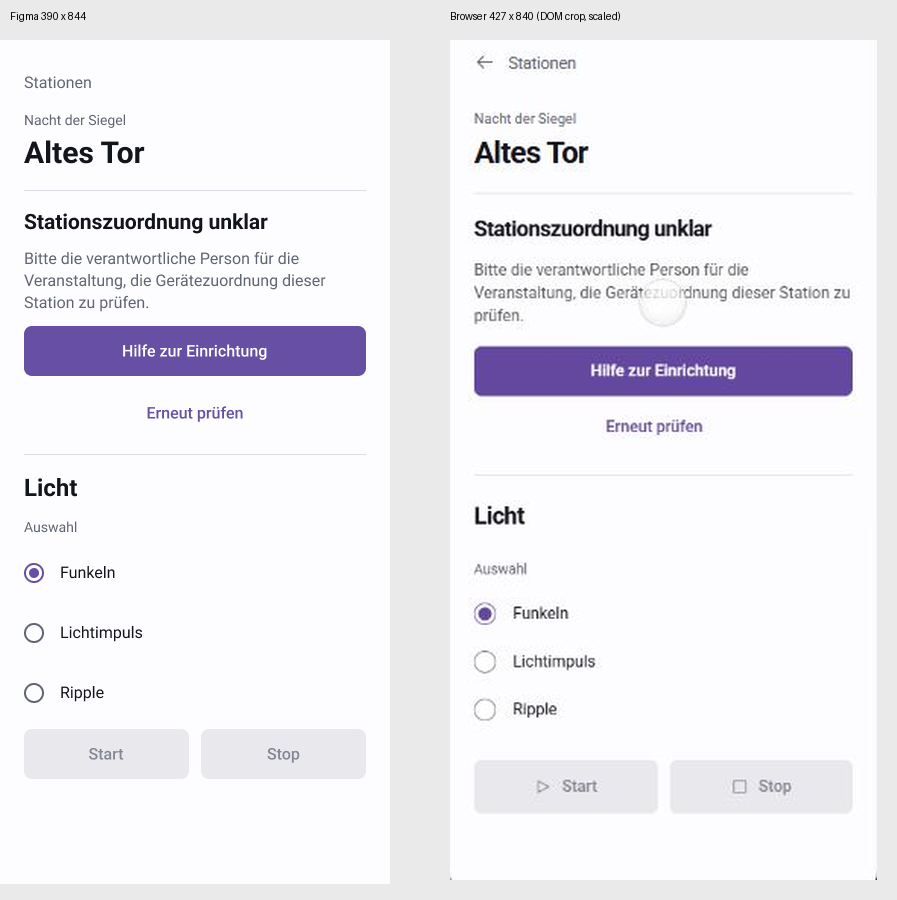

# Figma-Abgleich und PR-Review

18. Oktober 2026. Auftrag: Figma auf aktuellen Prototypstand ziehen, dann PR #78 prüfen.
Geprüfte Produktquelle: `1dc92278501e0362774dee8cd589bce65e62852e`.
Dieser Folgecommit ändert ausschließlich Dokumentation und Prüfbelege.

**Ergebnis: Drei P2-Korrekturen in Figma nachgeführt. Kein verbleibender P1/P2-Befund
im geprüften Pilotumfang. Der PR ist als Design-/Prototyppaket geeignet.**
Keine native Produkt-, Geräte- oder Nutzerabnahme und kein Merge.

## Entwurf

[Normalweg](https://www.figma.com/design/3uQpZfwREhQ9cHk80jMtRw?node-id=3-20),
[Testfälle](https://www.figma.com/design/3uQpZfwREhQ9cHk80jMtRw?node-id=16-1057),
[Einrichtungshilfe](https://www.figma.com/design/3uQpZfwREhQ9cHk80jMtRw?node-id=16-334).

56 aktuelle Stationsscreens und ein separater Testbereich; drei alte technische
Screens bleiben ausschließlich Archiv. Bestehende lokale Komponenten und acht
Farbvariablen wiederverwendet. Keine Code-Connect-Mappings für diese Komponenten
im Projekt vorhanden; kein neuer Komponenten-/Tokenstandard. Die Stationsscreens
enthalten 691 Roboto-Textknoten und 150 Komponenteninstanzen, keine IMAGE-Fills.
148 aktive Verknüpfungen einschließlich Testbereich haben gültige Ziele auf der
aktiven Seite. Zwei benannte Präsentationseinstiege: Normalweg und Testsimulation.

Einrichtungshilfe nennt Kontext, zuständige Person und passende Prüfschritte.
Rückkehr erhält den Fehler. Erneut prüfen führt über Suche/Zugang wieder zum Fehler.
Externe Korrektur ist nur im separaten Testbereich erreichbar; auch danach ist eine
neue Prüfung nötig. Eigene Hilfevarianten erhalten diesen korrigierten Kontext.

Vier Auftragsketten: offen → unbekannt → automatisch verbinden → prüfen → frischen
Zustand zeigen, ohne automatischen Rückweg zum Auftrag. Endzustände für Start
zugestellt / nicht zugestellt und Stop zugestellt / nicht zugestellt:
Funkeln / Licht aus / Licht aus / Funkeln. Wartezeiten entsprechen der Simulation:
1,7 s Auftrag, 2,4 s Unterbrechung und je 0,9 s Suche/Prüfung.
Abbrechen führt zu pausierter Verbindung; erst Erneut verbinden startet die Prüfung.

## Nachprüfung

| Schritt | Nachweis | Ergebnis |
| --- | --- | --- |
| 1 | Quelltext, Pilotvertrag und berührte Figma-Screens verglichen | Passend |
| 2 | Beide Hilfen als vollständige Figma-Frames gerendert | Kontext, Schritte, Rückweg vorhanden |
| 3 | Hilfe → Stationsfehler → Erneut prüfen in Figma-Presentation bedient | Derselbe Zuordnungsfehler bleibt |
| 4 | Vier Auftragsketten und Endzustände strukturell geprüft | Korrekt, kein automatischer Befehlsretry |
| 5 | Nicht angekommenen Stop in Figma-Presentation gestartet | Automatischer Endscreen 16:1011 zeigt weiter Funkeln |
| 6 | Alle Ziele, Fonts, editierbare Ebenen und Rasterfüllungen geprüft | 148 gültige Ziele, nur Roboto, keine UI-Rasterbilder |
| 7 | Browser neu auf Fehler/Hilfe bedient, gemeinsame Bildvergleiche geöffnet | Inhalt und Aufgabenhierarchie passen |
| 8 | PR-Code, Dokumentation, Tests und CI geprüft | Lokale Prüfungen bestanden, CI siehe unten |

Figma-Presentation im In-App-Browser: sichtbare Screenshots und wechselnde
node-id-URLs belegen die genannten Übergänge; nicht alle 56 Screens einzeln
bedient. [Frame-Index und Verknüpfungen](evidence/figma-sync/navigation.json)
sind erhalten. Vier vollständige Figma-Exporte lokal gespeichert und geöffnet.

## Sichtvergleich

Figma 390×844, Browser intern 427 px breit, bei 1280×720-Aufnahme verkleinert.
DOM-Apprechteck: x499,949 / y47,014 / Breite280,767 / Höhe594,411.
Ausschnitt aus unveränderter Vollaufnahme: (500,89) bis (781,642), nach Entfernen
der oberen 64 nativen Safe-Area-Pixel; auf 427×840 normalisiert. Originale erhalten.
Beide folgenden gemeinsamen Vergleichsbilder tatsächlich geöffnet:

Keine abgeschnittenen Hauptinhalte oder fehlenden Aktionen in den vollständigen
Exporten. P3: nominale Breite, Radiozeilenabstände und Standardicons weichen ab.
Keine pixelgenaue Compose-Vorgabe. Presentation-Aufnahmen mit 720 px Höhe zeigen
nur einen Teil des 844-px-Frames; Layoutbewertung anhand vollständiger Exporte.

## Software und CI

Frisch geprüft: 19 Zustandsregeltests, vier Worker-/Packagingtests, TypeScript,
Integrität aller 28 Runtime-Dateien und Produktionsbuild erfolgreich.
Die älteren Design-/PO-Belege sind historisch gekennzeichnet; aktueller Pilotvertrag,
README und Figma-Abgleich widersprechen einander nicht mehr.

Alle drei PR-Workflows am Inhaltscommit 1dc9227 erfolgreich abgeschlossen:
[Quality](https://github.com/Sven401/Larp-Escape/actions/runs/39163205540),
[LED product](https://github.com/Sven401/Larp-Escape/actions/runs/39163205436),
[NFC probe](https://github.com/Sven401/Larp-Escape/actions/runs/39163205405).
Neue Checks dieses Dokumentations-/Belegcommits gesondert prüfen; alte Läufe
werden nicht als Nachweis eines neuen Commits ausgegeben.

## Grenzen

Reale Einrichtung und Kontaktperson, Mehrstationsbetrieb, native Android-/BLE-,
TalkBack-, Lifecycle- und Nutzerabnahme bleiben offen. Figma zeigt repräsentative
Funkeln-Screens und feste Testpfade; der Browser bleibt interaktives Zustandsmodell
für Effektwahl und Schriftvergrößerung. Frühere 200-%-Prüfung ist kein neuer
Figma-/Accessibility-Nachweis. Keine vollständige Barrierefreiheit behauptet.
