# PO-Nachprüfung zu PR #78

Datum: 18. Oktober 2026. Auftrag: drei P2-Befunde aus der PO-Bewertung beheben
und den überarbeiteten Prototyp erneut prüfen. Ausgangscommit `c04a540bfebb1a633f104232ee4eb9d57996d4eb`.
Geprüfter Code: die mit diesem Bericht versionierten `src/Prototype.tsx`,
`src/pilot.ts` und `src/prototype.css`; SHA-256 im [Prüfmanifest](evidence/po/manifest.json).

**Ergebnis: alle drei P2-Befunde im begrenzten Browserpilot geschlossen.
Der Pilot ist als Grundlage für die native Umsetzung fachlich tragfähig.**
Keine Freigabe einer einsatzfertigen Android-App, keine Geräte-/Nutzerabnahme.

## Befunde und Korrekturen

| ID | Vorher / Nutzerauswirkung | Korrektur | Nachprüfung |
| --- | --- | --- | --- |
| PO-P2-01 | Einrichtungsfehler ohne konkrete Zuständigkeit; Wiederholbutton reparierte die Simulation | Kontextbezogene Hilfe für Zuordnung und Zugang, verantwortliche Person und Prüfschritte. Rückkehr erhält Fehler. Erneut prüfen verändert die Konfiguration nicht. Externe Korrektur ausschließlich getrennt in der Teststeuerung | Schritte 7–15; beide Fehler wiederholt, danach getrennte Korrektur und neue Prüfung |
| PO-P2-02 | Antwortverlust bedeutete im Modell immer ausgeführten Auftrag | Gerätezustand wird nicht mehr beim Absenden geändert. Getrennte Simulationsausgänge ausgeführt/nicht angekommen für Start und Stop | Schritte 2–6; vier Modellfälle prüfen unveränderten Befehlszähler bei Reconnect und abgewiesene späte Antwort |
| PO-P2-03 | Aktuelle Automatik und alte manuelle Übergänge im selben Brief | Ein aktueller Zustands- und Akzeptanzvertrag in BOX-PILOT.md; frühere Tabelle und Hypothesen separat historisiert, alter Bildentwurf als ersetzt markiert | Quervergleich mit Reducer, Timerübergängen und Browserpfaden; keine manuelle Kandidatenwahl im aktuellen Vertrag |

## Aktueller Prüflauf

In-App-Browser, Produktionsbuild lokal auf Port 4174, Browseraufnahme 1280×720;
Pixel-10-Vorlage mit internem 427×952-Raster, automatisch verkleinert.
Alle folgenden Screenshots sind neu in diesem Lauf aufgenommen, als unveränderte
PNG gespeichert und nach dem Speichern geöffnet. Die Teststeuerung liegt außerhalb
des Telefons; sie ist kein Bestandteil der Spielleitungsansicht.

| Schritt | Bedienung / Beobachtung | Zustand |
| --- | --- | --- |
| 1 | Station antippen, ohne Such-/Kandidatenklick bis Bereit | Gut |
| 2 | Start ohne Zustellung: bei Wiederverbindung Ergebnis noch ungeklärt, Befehle gesperrt | Gut |
| 3 | Automatische Wiederaufnahme: Licht aus, Auswahl Funkeln erhalten | Gut |
| 4 | Start ausgeführt, Antwort verloren: nach Wiederaufnahme Licht: Funkeln | Gut |
| 5 | Stop nicht angekommen: nach Wiederaufnahme weiterhin Licht: Funkeln | Gut |
| 6 | Stop ausgeführt, Antwort verloren: nach Wiederaufnahme Licht aus | Gut |
| 7 | Unklare Zuordnung: Zuständigkeit, Hilfe und erneute Prüfung sichtbar; Start/Stop gesperrt | Gut |
| 8 | Hilfe nennt Veranstaltung, Station, Gerätezuordnung und konkrete Prüfschritte | Gut |
| 9 | Hilfe verlassen, Erneut prüfen: Zuordnungsfehler bleibt | Gut |
| 10 | Externe Korrektur simulieren: Fehler bleibt bis erneuter Prüfung, danach Bereit | Gut |
| 11 | Fehlender Zugang: eigene Hilfe zur Gültigkeit und Bereitstellung des Stationszugangs | Gut |
| 12 | Hilfe bei 200 % Schrift: Text bricht um, längerer Inhalt scrollbar | Gut |
| 13 | Hilfe bis Rückkehrbutton gescrollt, Zur Stationsbedienung tatsächlich bedient | Gut |
| 14 | Zugang erneut prüfen ohne Korrektur: Fehler bleibt, keine Freigabe | Gut |
| 15 | Zugangskorrektur getrennt simuliert, erneute Prüfung bis Bereit, Schrift zurückgesetzt | Gut |

## Belege in Prüfreihenfolge

### 1. Station automatisch verbunden, Licht aus.

### 2. Start ohne Zustellung: Wiederaufnahme mit ungeklärtem Ergebnis und gesperrten Befehlen.

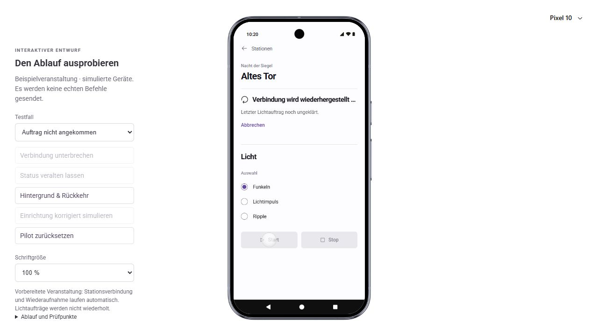

### 3. Nicht angekommener Start: Licht bleibt aus.

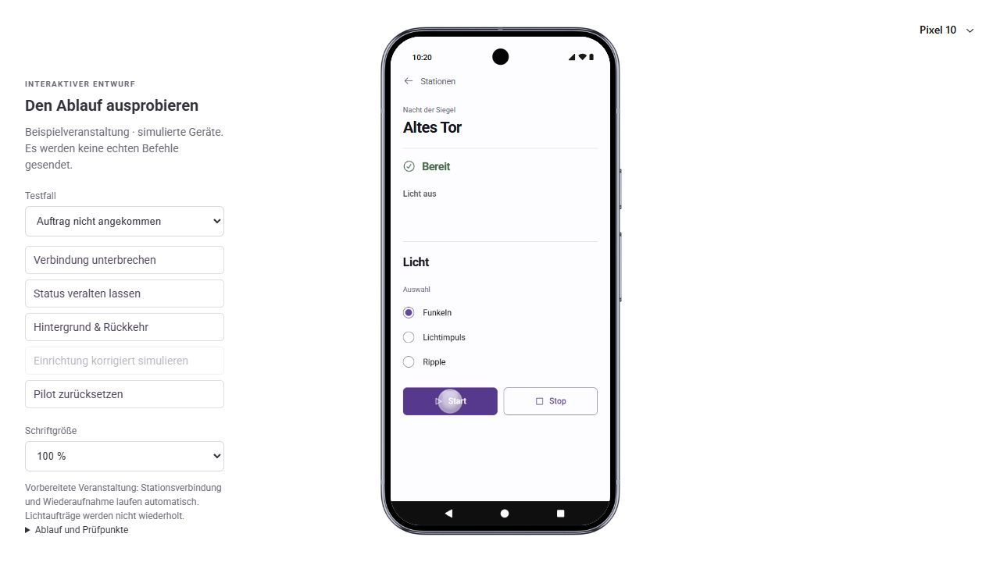

### 4. Ausgeführter Start ohne Antwort: frisch gelesener Zustand Funkeln.

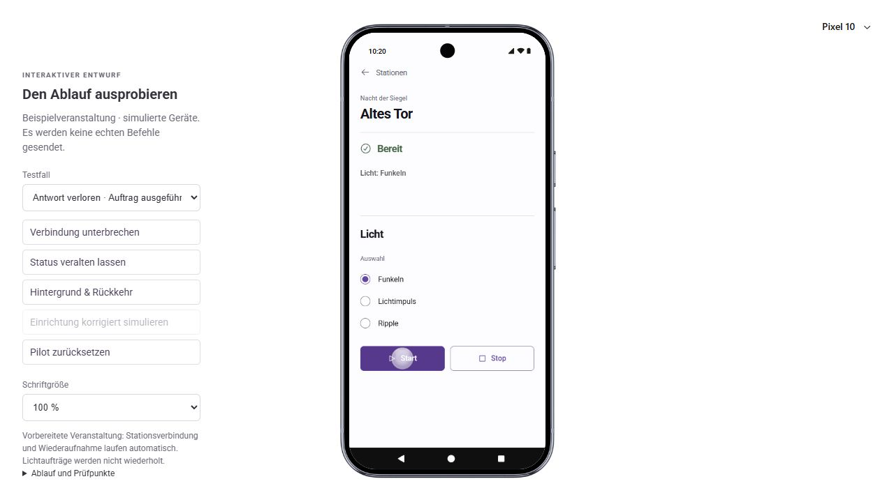

### 5. Nicht angekommener Stop: Funkeln läuft im simulierten Gerät weiter.

### 6. Ausgeführter Stop ohne Antwort: frisch gelesener Zustand Licht aus.

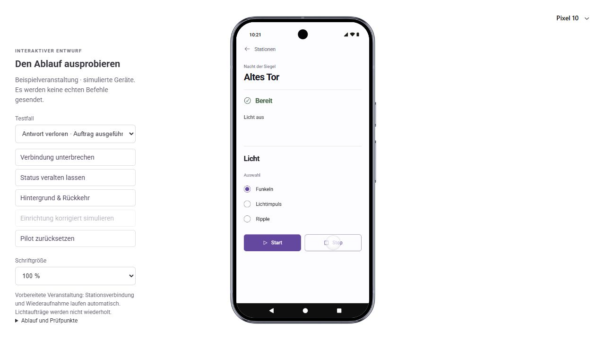

### 7. Zuordnungsfehler mit klarer Zuständigkeit und Hilfe.

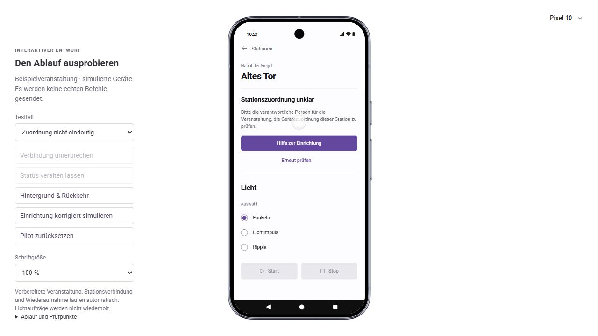

### 8. Konkrete Hilfe zur Zuordnung mit Rückweg.

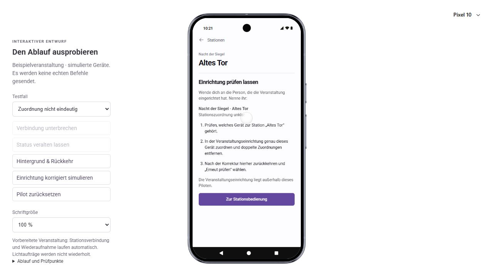

### 9. Keine Reparatur durch Wiederholung.

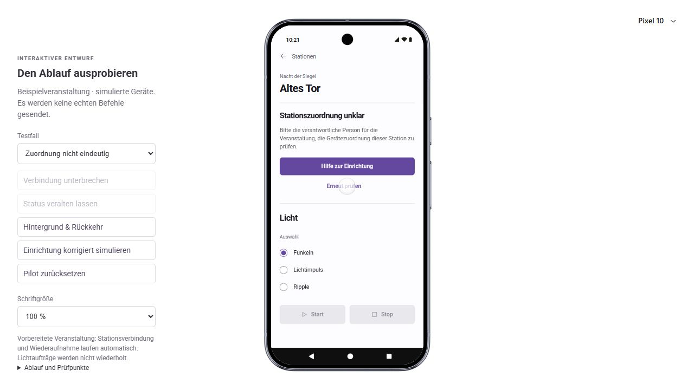

### 10. Freigabe nach externer Korrektur und neuer Prüfung.

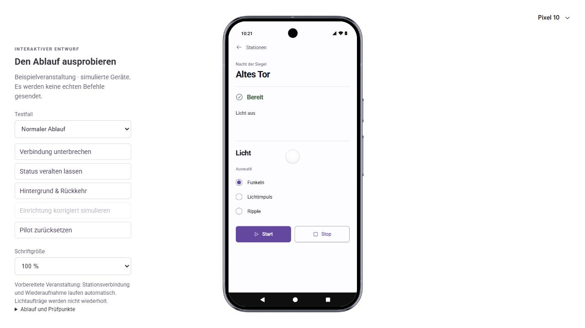

### 11. Eigene Hilfe bei fehlendem Stationszugang.

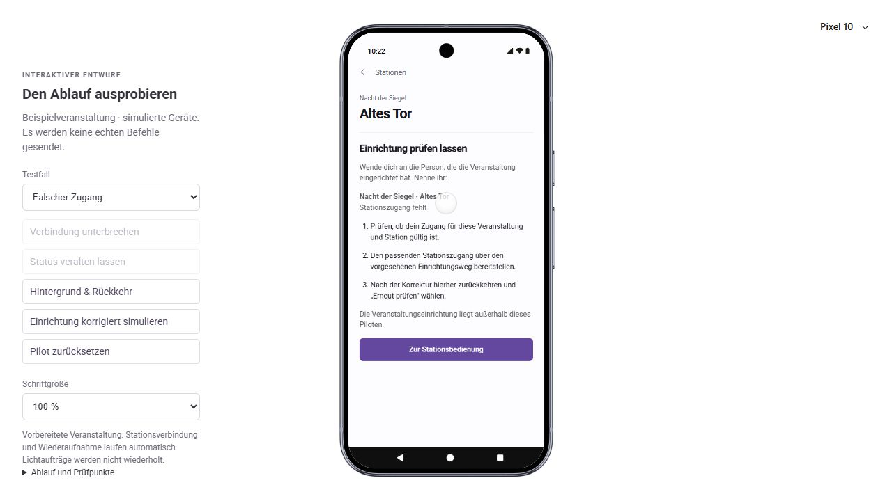

### 12. Hilfe bei 200 % Schrift, oberer Teil.

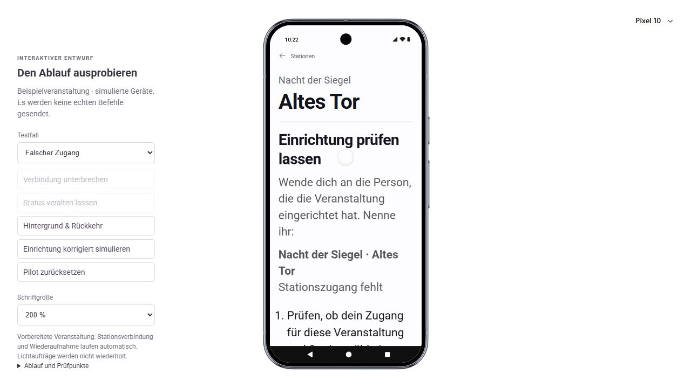

### 13. Rückweg bei 200 % Schrift nach Scrollen erreichbar und anschließend bedient.

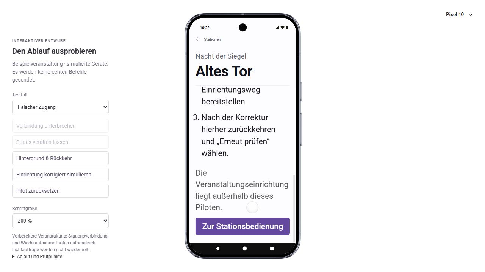

### 14. Zugangsfehler auch nach erneuter Prüfung weiterhin gesperrt.

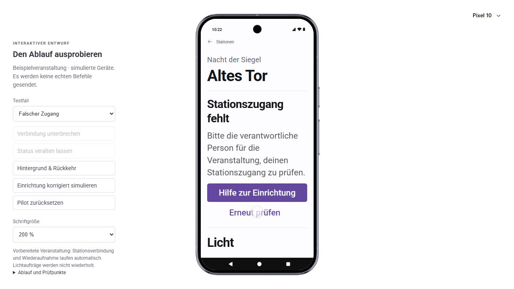

### 15. Neue erfolgreiche Zugangsprüfung nach externer Korrektur.

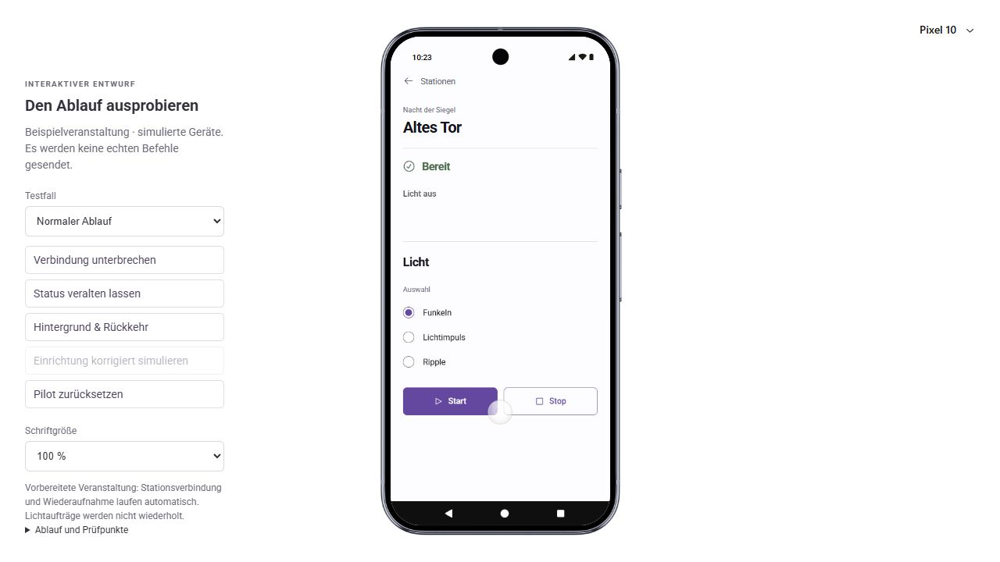

## Softwareprüfungen

- 19 Zustands-/Befehlsregeltests erfolgreich, einschließlich vier Start-/Stop-Ausgänge und fortbestehender Einrichtungsfehler.
- TypeScript-Typprüfung erfolgreich.
- Vite-Produktionsbuild und Packaging erfolgreich; vier Worker-/Packagingtests erfolgreich.
- Integritätsprüfung: alle 28 geschützten Runtime-Dateien unverändert.
- Whitespaceprüfung und lokale Markdown-Ziele der geänderten Dokumente geprüft.

Der erste normale Buildversuch traf die Sandbox-Schreibsperre im gemeinsam
verknüpften Dependency-Cache; kein Produktfehler. Erfolgreicher Build mit
`node node_modules/vite/bin/vite.js build --configLoader native`, anschließend
`node scripts/prepare-sites-build.mjs`. Die lokale Produktionsvorschau umgeht
Dependency-Optimierung und wurde für den Browser außerhalb der Socket-Sperre gestartet.
Die geschützte Vite-Konfiguration und Runtime wurden nicht geändert.

## Grenzen und nächste Produktabnahme

Keine verbleibenden P1/P2-Befunde in den drei beauftragten Korrekturen.
Die Hilfe macht die Übergabe handlungsfähig; reale Veranstaltungseinrichtung und
konkrete Kontaktperson werden damit nicht implementiert oder erfunden.
Die 200-%-Prüfung belegt sichtbaren Umbruch, Scrollen und erreichbare Rückkehr,
keine vollständige Barrierefreiheit. Native 320-dp-Prüfung, TalkBack, tatsächliche
OS-Berechtigungen, Rotation/Prozessneustart, BLE und Nutzerabnahme bleiben offen.
Mehrstationsauswahl und Stationswechsel sind unverändert unvalidiert.

Figma wurde in dieser Korrektur nicht geändert: bisheriger visueller
Ausgangsentwurf, keine aktuelle Spezifikation der neuen Hilfe. Der alte
[Designvergleich](design-qa.md) bleibt ausdrücklich historisch. Maßgeblich sind
[aktueller Vertrag](../../docs/ui-ux/BOX-PILOT.md), dieser Prüflauf und der Browser.
Vor einer Übergabe allein aus Figma muss die neue Hilfe dort nachgeführt werden.
