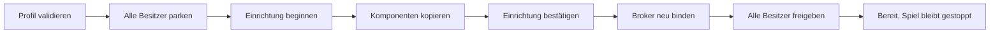

# Kontrollierte Profilübernahme

Übernahmeschnitt `9f27e46`, 6. Oktober 2026; dessen Buildzahlen unten bleiben datiert. `DeviceRuntime::Runtime` verbindet Profilplanung, Gerätebroker und Spielsitzung mit einem begrenzten Übernahmeprotokoll. Rechnerbesitzer und ein separates ESP32-Bauziel führen dieses Protokoll mit synthetischen Geräten aus. Reale profilabhängige Treiber, Produktionsanschluss, persistente Slots und Companion-Transport fehlen noch.

## Besitz und Revisionen

Genau ein Anwendungskontext besitzt `Runtime`; dessen Broker und Session sind privat. Während einer Übernahme oder im Fehlerzustand werden Spielbefehle abgewiesen. Snapshots sind Wertkopien für diesen Anwendungskontext, keine automatische Synchronisierung mit beliebigen anderen Tasks.

| Wert | Bedeutung |
| --- | --- |
| `configurationRevision` | Lokaler Übernahmestand; steigt nur bei erfolgreicher Übernahme eines Kandidaten. Erwarteter Wert bei `activate` und `startGame`. |
| `profileRevision` | Im JSON angegebene Revision des aktiven Dokuments; wird nicht als monotoner Geräteversionszähler behandelt. |
| Generation | Geräteinstanz einer Einrichtung. Auch eine Rückkehr zum alten Profil verwendet eine neue Generation. |
| Zustandsrevision | Session-/Graphstand; erwartet bei Stop, Pause, Fortsetzen und manuellen Zustands-/Kantenwechseln. |

`activate(candidate, expectedConfigurationRevision, now)` setzt ein bereits **gestopptes** Spiel voraus. Pause genügt nicht. Validierung und Planerstellung erfolgen vor der Stilllegung; ein ungültiger Kandidat verändert die aktive Einrichtung nicht. Angenommene Übernahme bedeutet zunächst `Queued`, nicht bereits `Applied`.

Aktives Profil und Kandidat sind unveränderliche, geliehene Speicherbereiche: aktiv bis zur erfolgreichen Ersetzung, Kandidat bis zum Abschluss der Übernahme. Keine Task bekommt einen Profilzeiger. Die Durchsetzung dieser Speicherlebensdauer durch einen aktiven/Entwurf-Speicher ist noch offen; ein Aufrufer darf die Bereiche weder überschreiben noch freigeben.

## Ablauf und Gerätevertrag



Fünf Besitzer: NFC, I2C, Audio, LED und Peer. `IControlChannel` überträgt kopierte `Control`-/`ControlReply`-Werte, FIFO je Besitzer, ohne Rückruf oder Queue-Warten. Ein vollständiges Ticket enthält Generation, Sequenz, Besitzer und Operationsart. Erst die passende terminale Antwort bewegt den Koordinator weiter. Alte und doppelte Antworten werden gezählt und verworfen.

| Operation | Voraussetzung für `Applied` durch einen echten Besitzer |
| --- | --- |
| `Park` | Autonome Treiberarbeit und laufende Vorgänge stoppen oder abbrechen; angenommene Jobs beenden; spätere Callbacks der alten Einrichtung ausschließen. Erst dann `parkOwner`. |
| `Begin` | Alte Treiberressourcen bereinigen; neue Generation, geplante Busse, Funkkanal und erwartete Komponentenanzahl übernehmen. Auch Besitzer ohne neue Komponenten durchlaufen diesen Schritt. |
| `Component` | Vollständige Einstellungen in eigenen Speicher kopieren und Einrichtung durchführen. IO-Expander kommen vor abhängigen Matrizen. |
| `Commit` | Alle erwarteten Komponenten vollständig eingerichtet; physische Einrichtung tatsächlich erfolgreich. |
| `Resume` | Neue Gerätegeneration übernehmen und Anfangsbeobachtungen publizieren, bevor die Antwort die Anwendung erreicht. Bei fehlenden Messungen `available=false` melden. |

`OwnerConfiguration` speichert vollständige `Component`-Werte und globale Mailboxslots. Es prüft Anzahl, Besitzer, Generation, doppelte IDs/Slots und frühere Matrixexpander. Dieses Hilfsobjekt richtet selbst keine Hardware ein. Ein erfolgreiches `commit` ersetzt keine Treiberprüfung.

Nach fünf Park-Antworten muss zusätzlich `IChannel::quiescent()` gelten. Leere FIFOs reichen nicht, laufende Jobs zählen weiterhin. Nach Commit bindet der Broker den neuen Plan, während alle Besitzer geparkt sind. Erst nach fünf Resume-Antworten setzt Runtime `hardwareReady=true`. Das Spiel wird durch die Kernklasse **nicht automatisch gestartet**.

Parken geschieht schrittweise: bisherige Besitzer dürfen vor ihrem eigenen Park bereits angenommene Jobs beenden. Abgebrochene Lesungen ergeben `Unavailable`, nicht eine angeblich frische leere Karte. Stop allein entleert die Gerätequeues nicht.

## Fehler, Grenzen und Rückkehr

- Pro Operation **5.000 ms**, einschließlich Wartezeit auf Queueannahme. Ein angenommenes Kommando wird nicht nochmals gesendet. Nur eine abgewiesene Queueannahme wird mit demselben Ticket erneut versucht.
- Pro Einrichtungsversuch **60.000 ms**, einschließlich Verzögerungen im Anwendungslauf. Rückkehr und abschließende Stilllegung erhalten jeweils eine eigene Frist.
- Ein `service` leert höchstens fünf Kontrollantworten und acht Geräteantworten; danach höchstens ein Einrichtungsschritt. Keine Warteschleife auf einen Worker.
- Abschlusszeiten stammen aus derselben monotonic Millisekundenuhr. Rechtzeitig beendete Operationen können später konsumiert werden; die Gesamtfrist bleibt maßgeblich. Kein Betrieb mit beliebig langen Uhr-/Serviceunterbrechungen zugesichert.
- Generationen und Sequenzen laufen nicht über. Vor Annahme werden drei Generationen und ausreichend Operationsnummern reserviert.

Ein Fehler mit vorherigem aktiven Profil startet unter neuer Generation erneut **Park → Einrichtung des vorherigen Profils → Freigabe**. Erfolgreiche Rückkehr ergibt `RolledBack`, unveränderte Konfigurationsrevision und ein gestopptes Spiel. Die ursprüngliche Fehleroperation, Komponente und Detailnummer bleiben im Snapshot erhalten.

Ohne vorheriges Profil oder bei gescheiterter Rückkehr folgt ein weiterer Parkversuch. Anschließend ist der Zustand `Fault` mit `Failed`, und Spielbefehle bleiben gesperrt. Fehler/Timeout bei dieser Bereinigung bedeutet ausdrücklich **keine bestätigte physische Stilllegung**. Reale Backends müssen etwa blockierende Treiber, Timer, Interrupts und Funkcallbacks in ihren Stilllegungsvertrag aufnehmen. Der Koordinator bietet bislang keinen hardwareseitigen Notaus.

Rückkehr, Timeout, Antwortverlust, alte Tickets und Grenzwerte sind im Code behandelt; diese Fehlerpfade wurden in diesem Schnitt nicht ausgeführt. Last-good-Speicherung, Stromausfallrecovery, exklusive Profilslots und dauerhafte Übernahmejournalisierung sind noch offen.

## Rechnerbedienung

```powershell
pio run -e profile-tools -j 2
.pio\build\profile-tools\program.exe --import docs/configuration/standard-profile.json --activate docs/configuration/hint-profile.json
.pio\build\profile-tools\program.exe --import docs/configuration/standard-profile.json --activate docs/configuration/extended-profile.json
.pio\build\profile-tools\program.exe --import docs/configuration/standard-profile.json --activate docs/configuration/setup-profile.json
```

Das Werkzeug richtet zunächst das Ausgangsprofil ein, startet das Spiel, stoppt es und übernimmt den Kandidaten einschließlich noch angenommener alter Ausgabejobs. Danach fordert es einen neuen Spielstart an. Kontrollablauf und Hardwarewerte erscheinen als JSONL, ohne Karten-UIDs. Die Rechnerbesitzer führen keine Hardwarewirkung und keine parallelen FreeRTOS-Tasks aus.

`setup-profile.json` wird durch `python scripts/generate_play_examples.py` aus dem Zusatzprofil erzeugt: LED-Pin **27** und **31 LEDs**, Audio-UART **2** und Lautstärke **19**, IO-Expanderadresse **0x22**. Kein Nachweis zulässiger realer Verdrahtung. Das Zusatzprofil enthält weiterhin Rolle 77/vier Kristalle/Zustand 88 und den veränderten Effekt.

Beobachtete normale Bedienung aller drei Kandidaten: zunächst 27, nach Wechsel insgesamt 54 bestätigte Kontrolloperationen; Konfigurationsrevision **1 → 2**, Generation **1 → 2**. Bei `Ready` vor erneutem Spielstart keine alten queued Jobs, zwei synthetisch abgebrochene Jobs, keine Antwortverluste oder Kontrollablehnungen. Andere alte Jobs konnten vor ihrem Park abschließen. Nach neuem Spielstart entstehen erwartungsgemäß neue Ausgabejobs. Kein Fehlerpfad- oder Schedulingnachweis daraus ableiten.

## ESP32-Probe und Speicher

`pio run -e esp32-profile-runtime-probe -j 2`: fünf Besitzer auf Core 0 mit je **4.096 Byte** statischem Stack, Anwendung im Arduino-Lauf. Standardprofil und Hinweisprofil liegen in zwei beim Start einmalig reservierten, fest begrenzten Profilspeichern; Zuweisungsfehler wird geprüft. Nach zehn Sekunden fordert die Probe Stop, Wechsel und erneuten Start an. Synthetische Karte/Matrixdaten sind vor Taskstart kopiert; Worker lesen keine Profile. Externe GPIOs, Busse, LEDs, Audio und Funk werden nicht initialisiert.

**Nur gebaut, nicht hochgeladen oder am Board ausgeführt.** Die vorher geprüfte USB-Diagnose bleibt auf dem Board. Heapreserve, Stackreserve, Fristen und echter FreeRTOS-Wechsel der neuen Probe sind damit noch nicht gemessen.

| Bauziel, 6. Oktober 2026 | Statisches RAM | App-Flash / 1.310.720 Byte |
| --- | ---: | ---: |
| Produktionsspiel, bisheriger Controller | 55.148 | 1.226.377 / 93,6 % |
| Bisherige USB-Diagnose | 21.480 | 291.673 |
| Profil-/Übernahmeprobe | 94.720 | 306.549 |

Die Probe reserviert zusätzlich **57.272 Byte Heap** für zwei volle Profile; dieser Bedarf ist nicht in der statischen RAM-Zahl enthalten. Beide Profile komplett statisch zu platzieren führte mit dieser Werkzeugkette zu einem tatsächlichen Linkerfehler: `.dram0.bss` um **27.408 Byte** überschritten. Das installierte `esp32/ld/memory.ld` begrenzt `dram0_0_seg` auf `0x2c200 - 0xdb5c = 124.580 Byte`; die PlatformIO-Gesamtanzeige von 532.480 Byte ist keine Grenze für diesen statischen Bereich. Die einmalige Bootreservierung bewahrt die Modellkapazitäten; sie beweist noch keine erfolgreiche Zuweisung auf dem Gerät.

Espressif beschreibt die Trennung zwischen statisch nutzbarem DRAM und weiterem Laufzeitheap sowie den Einfluss von Bluetooth auf Speicher: [Speicherarten](https://docs.espressif.com/projects/esp-idf/en/v4.4/esp32/api-guides/memory-types.html), [Heapverwaltung](https://docs.espressif.com/projects/esp-idf/en/v4.4/esp32/api-reference/system/mem_alloc.html). Die konkrete Grenze oben stammt aus dem lokal installierten Linkerskript, nicht aus einem allgemeinen ESP32-Budget.

ESP32-Compiler/ELF: `Runtime` **11.080**, `OwnerConfiguration` **3.032 je Besitzer**, FreeRTOS-Kanal **20.280**, fünf Probe-Worker einschließlich Konfigurationen/Stacks/Kontrollblöcken **41.920 Byte**. `Control` **212**, `ControlReply` **24 Byte**. Runtime enthält Session, Broker und beide Pläne; diese nicht nochmals addieren. Zwei Profile + Runtime + Kanal + fünf Ownerkonfigurationen ergeben mindestens **103.792 Byte** vor Stacks, Treiber-, Parser-, Funk- und Persistenzbedarf. Die vorhandene Produktions-App instanziiert diesen Pfad noch nicht; ihre Flashreserve ist knapp.

Frische `-fstack-usage`-Übersetzung mit Xtensa/`-Os`: größter einzelner Runtimeframe **336 Byte** (`activate`), OwnerConfiguration **64**, Lifecycle **32 Byte**. Gesamte Aufrufketten und Framework-/Taskstackbedarf kommen hinzu; keine gemessene Stackfreigabe.

## Prüfstand und nächster Schritt

Alle vier Bauziele erfolgreich, Rechnerquellen mit Warnungen als Fehler. Architektur **63 Dateien / 149 direkte Includes**, **42** isolierte reine Header, Format **107 Dateien** mit clang-format 19.1.7. Ausgewählte Cppcheck-2.1-Analyse der neuen Kern-/Werkzeugquellen ohne Befund; `git diff --check` ohne Befund. Bestehende Frameworkwarnungen bleiben sichtbar. Keine neue Unity-Suite ergänzt/ausgeführt, kein Upload oder Remote-CI.

Folgeschnitt: [PN532-Paket-/UID-Längenaudit und gepinnte Korrektur](../nfc-packet-contract.md) sind im Quellcode umgesetzt und erfolgreich gebaut; echte Leser-/Fehlerpfadabnahme bleibt offen. Als Nächstes profilabhängige Treiber mit tatsächlicher Stilllegung. Für die Companion-Schnittstelle zusätzlich aktive/Entwurf-Speicher, Persistenz, dynamischer Status, Anforderungs-IDs, Zugriffsschutz und direkter Appzugang ohne Router. Android und Feldenergieabnahme bleiben eigene Etappen.
