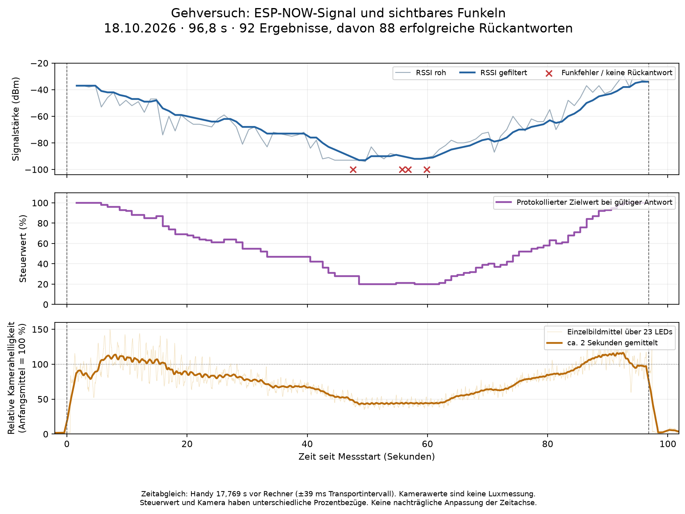

# ESP-NOW-Gehversuch mit Kameravergleich · 18.10.2026

Status: **vollständiges App-Messprotokoll und optischer Helligkeitsverlauf belegt**.
Nutzerablauf: zweiter ESP an Powerbank, entfernen, zurückkommen und die kombinierte
Messung am Handy beenden. Box und Kamera bleiben am Messplatz. Keine gemessenen
Meterabstände; RSSI betrifft die Funkstrecke zwischen den ESPs.

Arbeitsstand: `codex/espnow-app-bedienung`, vor diesem Bericht `da981ee45f17fd777d41cf96d91bf57edaa82229`.
Installierter App-Journalstand: `6e6f093`; Firmware-RSSI-Stand: `e012314` gemäß
vorherigem Installationsnachweis. In dieser Auswertung kein Upload oder Build und
kein erneuter Flash-Identitätsnachweis. Die isolierte Kamera-Prüffirmware war vor
dem Versuch bereits wieder durch die gesicherte Produktanwendung ersetzt worden.

## Vollständigkeit

- Messdauer vom Start- bis Stopereignis: **96,832 s**.
- **92 Anfragen, 92 Ergebnisse**, keine fehlenden oder doppelten Ergebnisnummern.
- **88 erfolgreiche Rückantworten (95,65 %)**, drei Funk-Sendefehler (Outcome 12)
  und ein Rückantwort-Timeout (13). Auch diese vier Fehler sind vollständig
  protokollierte Messpunkte; sie enthalten keinen gültigen RSSI-Wert.
- Start, LED-Startbestätigung, Stopanforderung und LED-Ausbestätigung vorhanden.
- Insgesamt 6674 Kamerabilder; davon **2897 innerhalb der App-Messdauer**.
  Die Kamera umfasst die Messung mit rund 109 s Vorlauf und 17 s Nachlauf.
- Alle Bilddateien gegen ihre beim Speichern erfassten SHA-256 geprüft.
  Helligkeitswerte zusätzlich über 31 über die Aufnahme verteilte Bilder und
  alle 23 Messflächen aus den Bildpixeln unabhängig nachgerechnet.

## Ergebnis

| Phase / Fenster seit Start | gefilterter RSSI, Median | Zielintensität, Median | relative Kamerahelligkeit, Mittel |
| --- | ---: | ---: | ---: |
| Anfang, 2–10 s | −41,5 dBm | 97 % | 100 % |
| Schwächste Phase, 46,624–51,624 s | −93 dBm | 20 % | 45,3 % |
| Rückkehr, 86,832–95,832 s | −41 dBm | 98 % | 108,3 % |

Gesamter Roh-RSSI-Bereich −94 bis −25 dBm, gefiltert −93 bis −34 dBm.
Die Steuerung nutzt den vollständigen Bereich 20–100 %. Das schwächste
gefilterte Signal wird bei 48,624 s protokolliert. Die vier Funkfehler liegen
bei 47,588 / 55,778 / 56,813 / 59,872 s in der schwachen Funkphase.

Die Kamera bestätigt den Abfall, die schwache Phase und die anschließende
Erholung. Pearson-Korrelation zwischen Zielintensität und Kameramittel in
festen Zwei-Sekunden-Fenstern mit mindestens einer gültigen RSSI-Antwort:
**r = 0,906**. Kein nachträglicher Zeitversatz zur Verbesserung dieses Werts.
Dies ist eine Beschreibung dieses Versuchs, kein unabhängiger Beweis einer
bestimmten Reichweite oder allgemeiner Funkzuverlässigkeit.

Erstes sichtbares Licht etwa 0,591 s nach App-Start; letztes oberhalb 10 % des
Anfangsmittels etwa 97,372 s nach Start, also rund 0,540 s nach der
Stopanforderung. Die App bestätigt Aus bei 97,400 s. Nachlaufmittel
(Stop +2 bis +6 s) rund 4,1 % des Anfangsmittels nach Hintergrundabzug:
sichtbare Abschaltung unterstützt, keine Aussage über exakt null Licht/Strom.

## Methode und Grenzen

Passiver Kameramodus: kein serieller Gerätezugriff und keine LED-Steuerung.
Verwendet wurden Aufnahmeflächen und feste Messpixel aus `suite-03` des
[Kameramesswegs in PR #68](https://github.com/Sven401/Larp-Escape/pull/68).
Gleiche zurückgelesene Einstellungen: 1280×720 MJPG, ca. 30 Bilder/s,
Belichtung −7, Gain 0, Gamma 100, Auto-Weißabgleich 0. Der Treiber meldet
Auto-Exposure weiterhin −1; die eindeutige Automatikabschaltung ist dadurch
nicht bewiesen. Aufbau per Kontextbild geprüft, keine erneute Einzelindex-
Kalibrierung in diesem Versuch. Keine gesättigten Pixel in den festen Messflächen.

Handyuhr liegt 17 769,035 ms vor Rechneruhr. Fünf Abfragen vor der Aufnahme
begrenzen den Offset auf [17 729,891; 17 808,178] ms, etwa ±39 ms um den
verwendeten Mittelpunkt. Nachherige fünf Abfragen ergeben den überlappenden
Bereich [17 728,372; 17 802,762] ms; keine aufgelöste Uhrverschiebung.
Dies begrenzt den Abfrageversatz, **nicht** Kamera-Belichtungs-, Puffer- oder
BLE-Antwortlatenz. Zeitstempel sind Host-Bildempfang beziehungsweise
App-Protokollierung; daher keine präzise Regelverzögerung aus diesen Daten.

Hintergrund pro Messpixel aus −5 bis −1 s vor Start abgezogen, negative Werte
auf null begrenzt. RGB-Kameracodes über 23 LEDs gemittelt; Anfangsfenster
2–10 s als relative 100-%-Referenz. Diagramm glättet die Kamera über 60 Bilder
(rund zwei Sekunden), um natürliche Funkelpulse vom Verlauf zu trennen.
Steuerprozente und Kameraprozente haben unterschiedliche Bezüge: 20 % Steuerwert
müssen wegen Kameraansprechkurve, Ganzzahl-RGB und Effektverteilung keine 20 %
Bildhelligkeit ergeben. Keine Luxmessung und keine lineare Photometrie.

Sieben Kameraempfangslücken >80 ms im Versuch, maximal 128,912 ms. Damit kein
lückenloser Nachweis einzelner Funkelimpulse und keine Übertragung des strengen
isolierten Laborurteils auf diesen Lauf. Hier wurden zeitlich gemittelte
Helligkeitsänderung, Protokollvollständigkeit und sichtbares Ende geprüft.
Eine vollständige TX_DONE-RGB-Sollspur wurde im Produktbetrieb nicht erfasst.

## Belege und Wiederholung der Auswertung

Private Rohbelege bleiben im Hauptcheckout, keine Zugangsdaten im Bericht:

- `private/espnow-app/camera-distance-20261018/`: 6674 PNG-Kacheln,
  Kontextbilder, `frames.csv`, `brightness.csv`, `status.json`, beide Uhrabgleiche,
  unveränderte `calibration.json` und `rois.json`.
- `private/espnow-app/journal-install-20261018/exports/143132-990372/`:
  `rssi-1792326592024-9c7fc953-3287-4d20-b04e-7c9c715af409.csv` und Vollständigkeitsbericht.
- CSV-SHA-256: `c95ddc82afbe258d170bda2b2d36560a8f12d927e81c3b65b82d71177a3037ec`.
- Auswertung unter `camera-distance-20261018/analysis/`: `report.json`,
  `bins.json`, `plot-data.npz`, `vergleich.png` und `vergleich.pdf`.
- Editierbare Auswertungsquellen: `private/espnow-app/analyze_distance.py`
  und `plot_distance.py`, Aufnahmequelle `camera_rssi.py`. Analyse liest
  ausschließlich erhaltene Belege; ihr Zielordner darf noch nicht existieren.

Keine Änderung an App oder Firmware durch diese Auswertung. Keine erneuten
Softwaretests erforderlich; die hier genannten Datei-, Pixel- und
Vollständigkeitsprüfungen wurden an dieser konkreten Messung ausgeführt.
