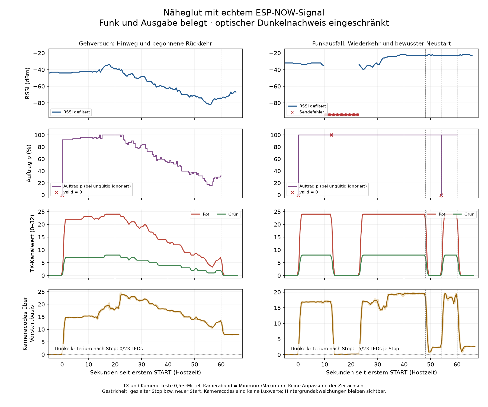

# Näheglut mit realen ESP-NOW-Messwerten · 18.10.2026

Status: **drei Laboraufnahmen abgeschlossen, digitaler Abschluss und Rückweg
belegt; vollständige optische Abnahme und Nutzerurteil offen**.
Auftrag: Geh- und Ausfallversuch mit dem bekannten Powerbank-ESP
`A8:42:E3:CE:DE:D8`. Der [Vorabplan](naeheglut-test.md) bleibt erhalten.
Dieser Bericht trennt reale Funkmessung, Effektberechnung, übertragene RGB-Werte
und Kamerabeobachtung.

## Aufbau und feste Arbeitswerte

Box `A8:42:E3:CD:4B:18` und Kamera bleiben am Messplatz; der Peer wird an
der Powerbank bewegt beziehungsweise ausgeschaltet. Die neue weiße Papierauflage
bleibt vor den LEDs. [Papier-CAL und begrenzte Goldreferenz](../led/paper-camera-calibration-2026-10-18.md)
beschreiben die neue Optik: CAL bei Belichtung −8 bestanden, Gold-Dynamikgrenze
an 19/23 LEDs verfehlt und untere Helligkeitsstufen nicht aufgelöst.

Umsetzungsstand: Arbeitscommit `e26bd93` auf `codex/naeheglut-espnow-test`;
Quellfingerabdrücke und tatsächlich verwendetes Binary sind separat erhalten.
Die isolierte RF-Laborvariante liefert `MEASURE`; der Host übersetzt bestätigte
Messwerte in normale `GLOW`-Updates desselben Näheglut-Kerns. Der Empfänger bleibt
unverändert. Keine Erweiterung der Produkt-BLE-Schnittstelle oder der Handy-App.

- Q8-Filter wie im vorhandenen RSSI-Pfad; ganzzahlige Ausgabe in dBm.
- `p = clamp(20 * (filtered_integer + 90), 0, 1000)`.
- 3000 ms ohne gültige Antwort: `valid=false`, kein alter 20-%-Fallback.
- RGB `(24,8,0)`, Gain 1000, Smoothstep 1000 ms, alle 23 LEDs gemeinsam.
- Nur bewusster Start erzeugt eine Instanz; gezielter Stop sperrt automatische
  Updates, ein weiterer Start braucht eine neue Generation.

Das belegt reale Funkmesswerte als Eingang des Versuchs. Es ist keine
Meterkalibrierung oder allgemeine Nähebestimmung; Körper, Ausrichtung und
Hindernisse beeinflussen RSSI.

## Durchgeführte Läufe und Ablaufkorrektur

Alle drei Aufnahmen endeten als `recorded` mit frischem Schwarztransfer und
DONE. Jede Anfrage besitzt ein Ergebnis und eine eindeutige, nicht leere
Funkkennung. Ergebnisse und Fehler wurden erhalten.

| Lauf | Funkergebnisse | gefilterter RSSI / p | Tatsächlicher Umfang |
| --- | --- | --- | --- |
| `walk01` | 160/160 gültig | −50…−22 dBm / 800…1000 | Gehversuch im oberen, oft begrenzten Bereich. Kein gezielter Instanzstop vor Ablauf der 80-s-Session; globaler Abschluss bestätigt. |
| `walk02` | 142/142 gültig | −82…−34 dBm / 160…1000 | Größerer Signalbereich, vorab getakteter Start und gezielter Stop; Funkmessung läuft nach Stop weiter. |
| `outage01` | 116 gültig, 26 Sendefehler mit Outcome 12; alle 142 zugeordnet | gültig −40…−22 dBm / jeweils 1000 | Ausfall, Veraltung, Wiederkehr sowie zwei gezielte Stops und bewusster Neustart mit Generation 2. |

Die Bereiche beziehen sich auf sämtliche Messungen des jeweiligen Laufs,
einschließlich Vorlauf und Stopfenster. Eine hohe Erfolgsquote in diesen kurzen
Läufen ist kein Reichweiten- oder Zuverlässigkeitsnachweis.

Bei `walk01` erreichte die Chatsteuerung den geplanten gezielten Stop nicht
rechtzeitig. Für `walk02` wurde der private Ablauf deshalb vorab getaktet:
Start bei 13,462 s, Stop bei 73,459 s der monotonen Hostzeit dieser Aufnahme.
Diese Zeitwerte enthalten den Aufnahmevorlauf; sie sind keine Lichtlatenzen.

Der letzte Filterwert von `walk02` ist −67 dBm, also p=460. Eine vollständige,
kontinuierliche Rückkehr zum anfänglichen Nahplateau ist damit **nicht belegt**.
Der größere Eingangsbereich und dessen Verarbeitung sind belegt; eine
abgeschlossene Nah–Fern–Nah-Abnahme wird daraus nicht behauptet.

## Ausfall, Wiederkehr und Stop

In `outage01` löst der Host beim protokollierten Alter **3016 ms** seit der
letzten gültigen Messung ein Update mit `valid=0` aus. Fehlerantworten erneuern
die Frische nicht. Die aktive Instanz blendet aus. Messung 57 ist wieder gültig,
mit neuer Empfängerbootkennung und Zähler 1; Roh- und Filterwert sind −34 dBm.
Der bestehende aktive Effekt erholt sich mit frischen Daten.

Nach dem ersten gezielten Stop bleiben weitere gültige Messwerte wirkungslos,
bis Generation 2 bewusst startet. Nach dem zweiten Stop erfolgt ebenfalls
kein automatischer Wiederanlauf. Die Belege aus `capture.json`:

| Stopfenster | erfolgreiche neue Funkantworten | automatische GLOW-Updates vor nächstem Start/Ende |
| --- | ---: | ---: |
| `walk02`, Request 65 | 12 | 0 |
| `outage01`, Request 5 | 12 | 0 |
| `outage01`, Request 8 | 12 | 0 |

Jedes Fenster umfasst rund sechs Sekunden **ab Stopanforderung**, einschließlich
Ausblendung. Das ist keine Behauptung von sechs Sekunden optischer Dunkelheit.
Der globale STOP→DONE-Abstand beträgt 32,782 / 41,549 / 41,166 ms für die drei
Läufe. Dies sind beobachtete Hostzeiten, keine garantierten Obergrenzen.

## Unabhängiger Rechenabgleich und seine Grenze

Der Offline-Auswerter überträgt die Quellformeln unabhängig und verwendet
protokollierte Gerätezeiten von APPLIED und Frame-Einreichung. Er führt keinen
neuen C++-Test aus und passt keinen Zeitversatz an das gewünschte Ergebnis an.

| Lauf | nominal exakt passende Frames | eingeschwungene Abweichungen |
| --- | ---: | ---: |
| `walk01` | 2425/2425 | 0 |
| `walk02` | 2154/2154 | 0 |
| `outage01` | 2151/2153 | 0 |

Alle übertragenen Frames enthalten 23 gleiche Pixel. In `outage01` bleiben
zwei **nicht exakt passende Übergangsframes** sichtbar:

- Frame 178, Revision 3: übertragen `(21,7,0)`, nominal erwartet `(22,7,0)`.
- Frame 547, Revision 4: übertragen `(13,4,0)`, nominal erwartet `(12,4,0)`.

Die tatsächlichen apply-/render-Zeitpunkte und die nachfolgenden
ACK-/submit-Zeitstempel werden nicht identisch erfasst. Diese Zeitstempelgrenze
ist eine plausible Einordnung der Ein-Code-Abweichungen, **keine bewiesene
Ursache**. Für `outage01` gilt ausdrücklich
`full_nominal_replay_matches=false`; keine vollständige exakte Live-Rechenfreigabe.

Der JSON-Status `software_evidence_verified_optical_limited` betrifft die
geprüfte Zuordnung von Funk, Mapping, Frische und Endwerten. Er beseitigt weder
diese beiden Abweichungen noch fehlende optische Nachweise.

## Kamerabefunde: Stopkriterium nicht vollständig bestanden

Die Auswertung verwendet unveränderte feste CAL-Masken und je Lauf die eigene
Vorstartbasis. Es gibt keine nachträgliche Masken-, Basis- oder Zeitverschiebung.
Alle Messflächen bleiben ungesättigt; kein Bild wurde wegen Schreibstau verworfen.

| Lauf | Bilder | größte Empfangslücke / Lücken >80 ms |
| --- | ---: | --- |
| `walk01` | 2405 | 202,395 ms / 3 |
| `walk02` | 2144 | 91,727 ms / 3 |
| `outage01` | 2137 | 189,189 ms / 4 |

Die konservativen Stop-Prüffenster beginnen erst 1500 ms nach ACK und enden
200 ms vor neuem Start beziehungsweise globalem STOP. Kriterium: mittlerer
Restpegel höchstens 5 % der jeweiligen Goldmaximum-Referenz über Vorstartbasis.

| Prüfbereich | Ergebnis | Restpegel im RGB-Mittel über Vorstartbasis |
| --- | --- | --- |
| `walk02`, Request 65, 74,972–79,259 s; 129 Bilder | **0/23 bestanden** | +1,025…+13,199 Kameracodes |
| `outage01`, Request 5, 62,918–67,199 s; 116 Bilder | **15/23 bestanden** | −1,924…+9,978 Kameracodes |
| `outage01`, Request 8, 74,916–79,203 s; 129 Bilder | **15/23 bestanden** | +0,051…+9,734 Kameracodes |

In beiden Ausfall-Stopfenstern verfehlen die Indizes 1, 2, 3, 6, 7, 8, 9 und 10
das Kriterium. Digitale Schwarzframes sind nachgewiesen; eine vollständige
**optische Stopfreigabe wird nicht erteilt**.

Eine zusätzliche qualitative Sichtung der Durchführung verglich
`walk02/frame-000100.png` mit `walk02/frame-002100.png` und
`outage01/frame-002100.png`: keine hellen LED-Kerne wie beim Goldlicht,
aber teilweise hellerer Papierhintergrund. Das ist eine Stichprobe.
Verändertes Umgebungslicht ist eine mögliche Erklärung, bleibt jedoch
unbewiesen; die negativen quantitativen Stopbefunde werden nicht umgedeutet.

Feinstufen, exakte Goldfarbe, lückenlose Dynamik, Flimmerfreiheit und Lichtlatenz
sind nicht abgenommen. Die Gold-Dynamikgrenze bleibt an 19/23 LEDs verfehlt.
Relative Kameracodes sind keine Luxwerte und kein menschliches Farb-/Lichturteil.

## Zusammengeführter Verlauf



Das Diagramm zeigt `walk02` und `outage01` relativ zum ersten bewussten Start.
Funkwerte bleiben vollständig erhalten; bei Sendefehlern wird keine
RSSI-Verbindungslinie über die Lücke gezogen. TX- und Kamerawerte sind feste
0,5-s-Mittel ohne angepassten Zeitversatz. Die Kamera zeigt den mittleren
RGB-Pegel der 23 Masken über deren eigener Vorstartbasis. Die verschiedenen
Host-Empfangszeiten liefern keine synchronisierte Lichtlatenzmessung.

[Reduzierte Daten](probes/naeheglut/plot-summary.json) und
[editierbare Plotquelle](probes/naeheglut/plot_naeheglut.py) bleiben versioniert.
Reproduktion aus dem Repository mit Python und Matplotlib:

```powershell
python docs/espnow/probes/naeheglut/plot_naeheglut.py --data docs/espnow/probes/naeheglut/plot-summary.json --output docs/espnow/naeheglut-rssi-2026-10-18.png
```

## Rückweg und verbleibende Punkte

Die ursprüngliche Boxanwendung wurde anschließend wiederhergestellt.
`restore.json` bestätigt Anwendungsverifikation, unveränderte Boot-/Schlüsselbereiche,
Verifikation aller 4 MiB gegen die frische Sicherung und beobachteten Originalstart.
`restore-full-verify.log` meldet für 4194304 Byte `verify OK (digest matched)`.
Der Peer wurde nicht neu geflasht.

Offen bleiben das Nutzerurteil zu Wirkung und Tempo, die vollständig beobachtete
Rückkehr zum Nahzustand, die Ursache der beiden Rechenabweichungen und der
optischen Restpegel sowie eine feinere Gold-/Timingprüfung. Produktadapter,
Spiel-/App-Anbindung, Dauerbetrieb, elektrische Prüfung, Reichweite und
Gesamtspielabnahme sind nicht Bestandteil dieses abgeschlossenen Laborversuchs.

## Belege und reproduzierbare Herkunft

Private Rohbelege liegen unter
`C:/Dev/Larp Escape/private/naeheglut-espnow-20261018/`:
`walk01/`, `walk02/`, `outage01/` jeweils mit `capture.json`,
`camera.json`, Messjournal und `walk-analysis.json`; außerdem
`analyze_walk.py`, `analyze_gold.py`, Quellmanifest und Rückwegprotokolle.
Der Funkbeleg besteht aus zugeordneten Firmwareantworten; es gab keinen
unabhängigen RF-Paketsniffer. Bilder, Flashabbilder und private Gerätedaten
bleiben im privaten Belegordner.

| Artefakt | SHA-256 |
| --- | --- |
| Verwendetes RF-Laborbinary | `8c8ee844b9f7f18bfe20846f0a07946352677fdae27a998eab4e306f7fc0d27a` |
| Unveränderter interaktiver Host | `ec6ce2d96fee15699784f0fd601132b298cdf6bf141e56670d81b0ca9da5b620` |
| Offline-Auswerter | `5dd5cef66fbd318ef21beb63d75448da57ccda3d2c33589694668737287c89b9` |
| `walk01/walk-analysis.json` | `3d0a9872a66c9b12aa57ae0ddc3ac2295d7e3bcad11617dd72311323ecc9b258` |
| `walk02/walk-analysis.json` | `a6d1a3665122397b5c4bb5d46188feda0d7db904ecfbe1454649ac2ed47d3e9c` |
| `outage01/walk-analysis.json` | `c4bff845c24f6fc16e3e9b4af16440f115b6be084cf03bc1db6b738cc45b3030` |
| Wiederhergestellte Anwendung | `ed333fb42af533453eafd30aa4032d56e372016b8a658baee00eab7d8b5ef177` |
| Frische vollständige 4-MiB-Sicherung | `b703f4b13aaaaa3e8c3bc68d8e8134b1cec0a77df957ea06175ac147d1d03c71` |
| `restore.json` | `25881959e1d243bcdc9819ab696c0ff915a4b9600acdd93e349442f477bb1afc` |

Dokumentationsabgleich: gespeicherte JSON-Ergebnisse, Aufträge, Rückweglog
und Hashes gelesen; keine erneute Bildanalyse, Tests, Builds oder
Gerätehandlungen für diesen Bericht ausgeführt.