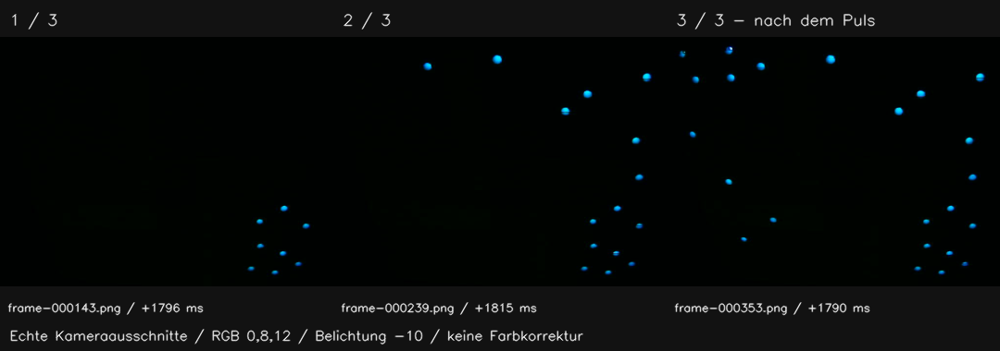
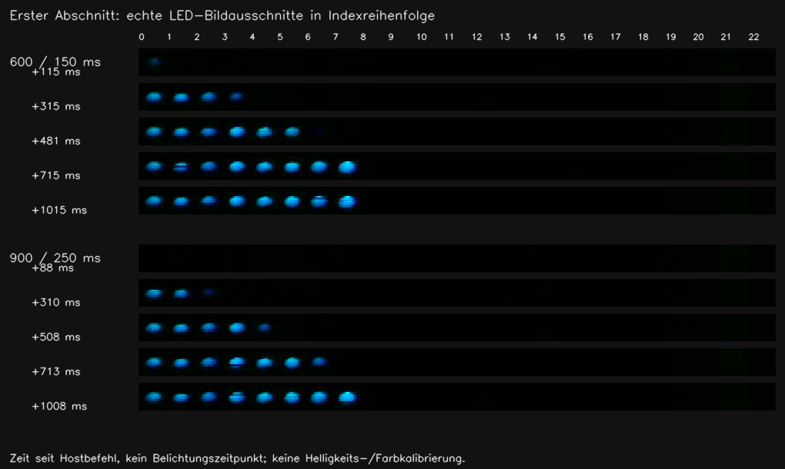
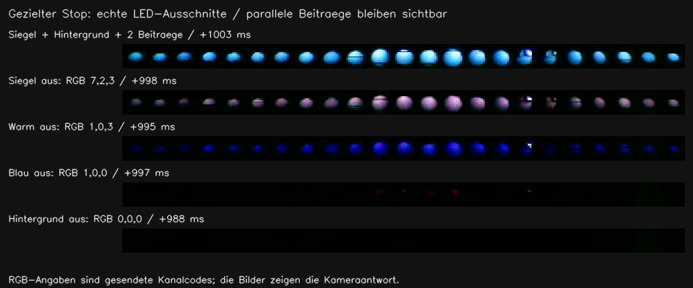

# Kristallsiegel: reale Lichtversuche und Rückweg

Stand: **20. Oktober 2026**. Status: **gemeinsamer Effektkern am Gerät erprobt;
gestalterischer Vergleich, keine Produkt- oder photometrische Abnahme**.
Quellstand aller Geräteversuche: `dc8c5d2358ffc4d5753b21c8806261046b4788d3`.
[Entwurf](kristallsiegel-design.md), [ausführbarer Vertrag](../../firmware/led/LIVE-CRYSTALSEAL.md),
[PR #89](https://github.com/Sven401/Larp-Escape/pull/89).

## Ergebnis und gestalterische Einordnung

Der echte Aufbau zeigt drei bleibende Fortschrittsgruppen. Auf der vorhandenen
Box liegt die erste Gruppe dicht unten rechts, die zweite rechts und oben,
die dritte links. Die 23 LEDs bilden **keinen regelmäßigen Kreis**; ihre Folge
verläuft teilweise im Zickzack. Der schematische Kreis im Entwurf ist daher
keine Darstellung der vorhandenen Geometrie. Drei anwachsende Bereiche sind
sichtbar; eine glatte Kreisbahn oder drei gleich große räumliche Bögen wären
eine unzutreffende Beschreibung dieser Box.



Die Ruhefarbe `(0,8,12)` erscheint im Kamerabild kühl blau-türkis. Ein zusätzlicher
einmaliger gemeinsamer Helligkeitsanstieg folgt auf den dritten Aufbau; danach
bleiben die Punkte ruhig. Korrektur, ungültiger Eingang und Wiederkehr wurden
getrennt erprobt. Die Kamera ersetzt kein menschliches Urteil über Farbe,
Helligkeit oder Lesbarkeit im Veranstaltungsraum.

**Parameteriteration:** V1b und V3 verwenden 600 ms Abschnittsaufbau und 150 ms
Einzelrampe. V2 verlängert ausschließlich diese Werte auf 900/250 ms. Beide
Varianten zeigen aufeinanderfolgende Lichtpunkte; die zweite verteilt den Aufbau
sichtbar länger und ist für die dicht liegende erste Gruppe die bevorzugte
gestalterische Arbeitsvariante. Das ist eine Beurteilung der Aufnahmen, kein
Nutzertest. Die ausführbaren Defaults bleiben 600/150 ms; 900/250 ms ist eine
bestätigt angenommene, am selben Kern erprobte Konfiguration. Farbe, Puls und
Snapshot-/Stopzeit bleiben unverändert.



Ein neuer Start dieser Arbeitsvariante muss beide Werte ausdrücklich enthalten:

```json
{"op":"seal-start","round":1,"gen":1,"count":0,"valid":1,"cause":0,"consumed":0,"rgb":[0,8,12],"peak_rgb":[4,18,24],"sweep_ms":900,"pixel_ms":250,"transition_ms":300,"pulse_ms":800}
```

Runde und Generation sind Beispiele für einen frischen Laborbesitzer. Alle
Folgebefehle verwenden die bestätigten Parameter wie im Laborvertrag.

## Aufnahme, Zuordnung und Grenzen

HD-Webcam, DirectShow, 1280×720, MJPG, angeforderte 30 fps, Belichtung −10,
Gain 0 und abgeschalteter automatischer Weißabgleich. Der Treiber meldet für
Auto-Exposure −1 zurück; daraus folgt kein belastbarer Nachweis ihrer Abschaltung.
Kamera und Box wurden zwischen den Läufen nicht umgestellt.

Vor dem Effektversuch wurden 23 Aufnahmebereiche gefunden und anschließend
alle logischen Indizes unabhängig in Vorwärts-/Gegenfolge bestätigt. Der CAL-Lauf
enthält 134 Stufen und 1310 Bilder, 30,03 fps, größte Bildlücke 62,98 ms.
`led_camera_assess.py map` besteht; die Radiometrie bleibt ausdrücklich ungeprüft.
Die Atlaspositionen wurden anhand des gespeicherten ROI-Layouts in die volle
Kameraansicht zurückgerechnet. [Beschriftete tatsächliche Zuordnung](probes/kristallsiegel/live/index-map-camera.png).

| Lauf | Inhalt | Kamerabilder / Rate | Größte Lücke | Ergebnis |
| --- | --- | --- | --- | --- |
| V1 | Erste Defaultprobe, Vollbild | 1038 / 26,94 fps | 176,21 ms | Abgebrochen: privater Ablauf blockierte den Host-Protokollkanal, Gerätewächter schaltete ab |
| V1b | Wiederholung; 0→1→2→3, Korrektur, ungültig/gültig, Stop | 914 / 23,57 fps | 1146,56 ms | Vollständig; Standbilder und digitale Spur brauchbar, kurze Bewegung optisch nicht lückenlos |
| V2 | 900/250 ms; schnelle Fortschritte, Snapshot 3, Stop in Aufbau/Puls | 1125 / 29,92 fps | 104,20 ms | Vollständig; verifizierte LED-Ausschnitte statt Vollbild gespeichert |
| V3 | Defaultvergleich; zwei weitere Beiträge und Hintergrund, getrennte Stops | 1094 / 29,84 fps | 169,82 ms | Vollständig; dieselbe Erfassung der LED-Ausschnitte wie V2 |

In V1b/V2/V3 wurden keine Bilder wegen einer vollen Schreibwarteschlange
verworfen. Alle drei überschreiten dennoch die vorhandene 80-ms-Grenze für eine
formale optische Zeitabnahme. Der Protokollstau in V1 entstand
im privaten zeitgesteuerten Aufrufer: stdout wurde zunächst in eine nicht laufend
geleerte Pipe umgeleitet. Die Wiederholung schreibt fortlaufend in eine Datei;
Firmware und Repository-Host blieben unverändert. V1 bleibt als unvollständiger
Versuch dokumentiert und ist kein Bestehensnachweis.

Die Vergleiche zeigen echte, unverändert gefärbte Bildausschnitte, teils skaliert.
Der [Kameraauszug als Animation](probes/kristallsiegel/live/camera-preview.webp)
verwendet V1b-Vollbilder, auf 100-ms-Schritte abgetastet; über Bildlücken werden
Bilder wiederholt. Er vermittelt die Erscheinung, keine optische Zeitmessung.
Empfangszeit, Geräteübertragung und tatsächlicher Belichtungszeitpunkt sind
verschiedene Zeitbasen. Keine vorhandenen automatischen optischen Abnahmeschwellen
wurden auf Türkis übertragen.

## Digitale Ausgabe und unabhängige Beiträge

Alle 9/15/11 verändernden Aufträge in V1b/V2/V3 wurden mit passenden Zuständen
bestätigt. Die getrennte Auswertung der tatsächlichen TX_DONE-Spuren liegt in
[digital-evidence.json](probes/kristallsiegel/live/digital-evidence.json);
[Prüfweg](probes/kristallsiegel/live/analyze_digital.py).
3369 fortlaufende Transferereignisse und 35 bestätigte verändernde Aufträge wurden
ohne verletzte Prüfung ausgewertet. Die schnelle V2-Folge traf tatsächlich nach
97 und weiteren 105 ms ein; ihre drei Abschnitte erreichten unabhängig nach
905/907/901 ms den Sollwert. Bei Stop waren alle Frames ab 300 ms am Ziel.
Früher sichtbare RGB8-Nullen durch Quantisierung verkürzen die interne Rampe nicht.
Die Auswertung prüft Fortschrittsstände, Pulswiederholung, Korrektur/Wiederkehr, Stop während
Aufbau/Puls und die gezielt erhaltenen Fremdbeiträge. Das sind digitale Belege,
keine Behauptung lückenlos beobachteten Lichts.

V3 mischt das Siegel mit Hintergrund `(1,0,0)` und den beiden Beiträgen
`(6,2,0)` / `(0,0,3)`. Nach Siegel-Stop bleiben `(7,2,3)`, nach Stop des warmen
Beitrags `(1,0,3)`, nach Stop des blauen Beitrags `(1,0,0)`; erst der ausgeschaltete
Hintergrund ergibt `(0,0,0)`. Die Bilder zeigen die erhaltenen Lichtbeiträge und
die abschließende Dunkelheit in den erfassten LED-Bereichen.



Alle drei vollständigen Läufe enden mit bestätigtem frischem Schwarzframe und
DONE. Ein dunkler Einzelbeitrag und ein schwarzes Gesamtbild bleiben verschiedene
Zustände. Die optische Aussage betrifft die gezeigten Bereiche, keine elektrische
Nullstromprüfung oder vollständige Dunkelmessung des Raums.

## Sicherung und verifizierte Wiederherstellung

Nutzerauftrag: **„Ja, Lichtversuch mit Sicherung und Wiederherstellung“**.
Die aktuelle Chipkennung wurde an COM3 mit dem dokumentierten Rückweg abgeglichen.
Vor dem ersten Schreibzugriff: frische vollständige 4-MiB-Lesung, Verifikation am
Chip und Prüfung der Partitionstabelle; Anwendungsbereich `0x10000..0x310000`.
Nur die Anwendung wurde beschrieben. Boot-/Partitionsbereich und Schlüsselbereich
wurden nach Installation und Wiederherstellung byteweise abgeglichen.

- Sicherung SHA-256: `b703f4b13aaaaa3e8c3bc68d8e8134b1cec0a77df957ea06175ac147d1d03c71`.
- Laborbinary: 287328 Bytes, SHA-256 `577d0b5a97e28f5a2c267aee0daf5a7bf34169a139b8baafbbafc27cd8c20ea3`.
- Wiederhergestellter Anwendungsbereich SHA-256: `ed333fb42af533453eafd30aa4032d56e372016b8a658baee00eab7d8b5ef177`.
- Nach Wiederherstellung: vollständige `verify_flash 0` über 4194304 Bytes,
  **digest matched**; Startmeldung **LARP LED-only ready** erneut beobachtet.

Private Rückwegdateien, Rohbilder, Ablaufpläne und vollständige Protokolle liegen
unter `private/kristallsiegel-20261020` im ursprünglichen Projektcheckout.
Flashabbilder und Schlüssel wurden nicht versioniert. Die öffentlichen
[Belegauszüge mit Quellenhashes](probes/kristallsiegel/live/evidence.json) und
[editierbare Auswahl](probes/kristallsiegel/live/collect_live_evidence.py) enthalten
keine Flashdaten.

## Softwarestand und offene Integration

Die vor dem Upload bestandenen [Hosttests und drei ESP32-Builds](../../firmware/led/LIVE-CRYSTALSEAL.md#softwareprüfung-und-grenzen)
beziehen sich auf den oben genannten Quellstand. Seine PR-CI ist grün:
[LED product](https://github.com/Sven401/Larp-Escape/actions/runs/39498633050),
[Quality](https://github.com/Sven401/Larp-Escape/actions/runs/39498633190),
[NFC probe](https://github.com/Sven401/Larp-Escape/actions/runs/39498633364).
Die Folgedokumentation ändert keine Effekt- oder Hostimplementierung.

Offen bleiben Spieladapter, Pause-/Profilverhalten, Priorität gegenüber anderen
Spieleffekten und das Nutzerurteil zur Wirkung auf der vorgesehenen Installation.
Der getestete USB-Laborbesitzer wird nicht als bereits bestehender Produktanschluss
ausgegeben. Es wurde kein neuer Dauerbetrieb auf der Box installiert.
