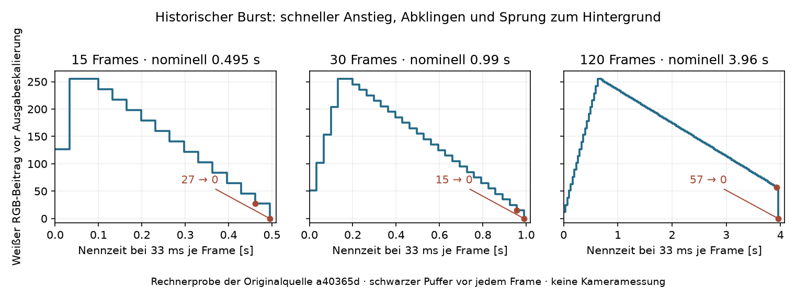

# Ursprünglicher Burst: Analyse und Vorbereitung der Kameraprüfung

Stand: **18. Oktober 2026**. Status: **Quellcodeanalyse und gezielte
Rechnercharakterisierung belegt; kein neuer Geräte- oder Kameratest.**
Referenz ist derselbe vom Nutzer benannte Live-Spielstand wie bei den
[ursprünglichen Wake-Ripples](legacy-wake-ripple-analysis.md):
`a40365d715b2055ee23f767fa53b55ac25243437`. Die historische Burst-Datei hat
Git-Blob `b2438b877cde21a90d8fefcdf7f031497761d330`, identisch zum Stand
`c4c8d9603d724c924ac12fa00dd6e1006dddccb9` („Last Changes bis Aufbautag“).
In diesem älteren Commit wurden Farbparameter und die grüne Idle-Anforderung
ergänzt. Der nachfolgende Refactor im Referenzstand ändert diese Burst-Datei nicht.
Die [ursprüngliche Funkelschicht](legacy-twinkle-analysis.md) ergänzt den
hier betrachteten Hintergrund und dessen Spiel-/Palettenübergänge.

## Ergebnis

Der ursprüngliche Burst ist **ein gemeinsamer Lichtpuls über alle 23 LEDs**.
Er steigt schnell an, klingt länger ab und wird auf Funkeln beziehungsweise
den vorhandenen Bildpuffer addiert. Normalfarbe ist Weiß; ein Farbparameter
ist möglich. Eine einzige globale Burst-Instanz dient den Zustandswechseln.
Sie startet beim Boot nicht automatisch.

Die im Spiel verwendeten Dauern sind 15, 30 und 120 **Zeichenschritte**. Ein
bereits laufender Puls verhindert einen neuen Start, übernimmt im Original
aber trotzdem dessen Farbe. Am Ende verschwindet der Burst-Beitrag sprunghaft
von einem noch positiven Wert. Er fordert selbst keinen schwarzen Frame an.

Quellen: [Burst-Berechnung und Startlogik](https://github.com/Sven401/Larp-Escape/blob/a40365d715b2055ee23f767fa53b55ac25243437/lib/LedFx/burst.cpp#L7),
[Standardparameter im Header](https://github.com/Sven401/Larp-Escape/blob/a40365d715b2055ee23f767fa53b55ac25243437/lib/LedFx/burst.h#L14),
[LED-Task und globale Instanz](https://github.com/Sven401/Larp-Escape/blob/a40365d715b2055ee23f767fa53b55ac25243437/src/main.cpp#L30).

## Helligkeitsverlauf und Farbe

Für Dauer `N`, Schritt `s=0..N-1` und `K=floor(N/6)` berechnet der Originalcode:

```text
B(s) = floor(255*(s+1)/K)                        für s < K
B(s) = 255 - (s-K)*floor(255/(N-K))              sonst
```

Die Ganzzahldivision ist Teil des Verhaltens. Insbesondere wird beim Abklingen
erst `floor(255/(N-K))` berechnet. Eine umgestellte, scheinbar gleichwertige
Berechnung oder ein auf null endender Float-Verlauf würde andere Werte liefern.



| Dauer | Nennzeit bei 33 ms je Schritt | Anstieg, Schritte | erster Beitrag | Maximalwert, Schritte nullbasiert | letzter Beitrag | danach bei frisch schwarzem Puffer |
| --- | ---: | ---: | ---: | --- | ---: | ---: |
| 15 | ca. 0,495 s | 2 | 127 | 255 bei 1 und 2 | 27 | 0 |
| 30 | ca. 0,990 s | 5 | 51 | 255 bei 4 und 5 | 15 | 0 |
| 120 | ca. 3,960 s | 20 | 12 | 255 bei 19 und 20 | 57 | 0 |

Damit besitzt jeder dieser Verläufe zwei aufeinanderfolgende Maximalframes.
Der 15-Frame-Puls beginnt bereits ungefähr auf halbem Roh-Maximum; der lange
120-Frame-Puls endet noch bei 57/255 und fällt danach auf den Hintergrund zurück.
33 ms sind die Wartezeit nach Zeichnen und `FastLED.show()`, keine gemessene
historische Bildperiode. Rechen-/Ausgabezeit, Taskwechsel und serielle Ausgaben
kommen hinzu; ein verlangsamt gezeichneter Burst dauert entsprechend länger.

Jede LED erhält denselben Beitrag `color.scale8(B,B,B)`. Bei der im Referenzstand
gepinnten FastLED-Version 3.10.5 und standardmäßig aktiviertem
`FASTLED_SCALE8_FIXED=1` ergibt ein Farbkanal `C` den Wert
`floor(C*(B+1)/256)`. Für Weiß `(255,255,255)` ist der Beitrag exakt `(B,B,B)`;
für Grün `(0,255,0)` exakt `(0,B,0)`. Diese Werte liegen vor globaler Helligkeit,
Farbkorrektur und möglicher Leistungsbegrenzung.

## Wann das Spiel Burst anfordert

Alle folgenden Aufrufe stehen im jeweiligen Eintrittsblock `machine.executeOnce`.
Ein fortgesetzt ausgeführter Zustand startet deshalb keine periodischen Bursts.

| Zustandseintritt | angeforderter Burst | gleichzeitig gesetztes globales Helligkeitsziel |
| --- | --- | ---: |
| Idle | 120 Frames Grün, unmittelbar danach 15 Frames Standardweiß; Sonderfall unten | 20 |
| WaitingForCrystals | 15 Frames Weiß | 50 |
| FirstCrystalPlaced | 15 Frames Weiß | 100 |
| SecondCrystalPlaced | 15 Frames Weiß | 150 |
| ThirdCrystalPlaced | 15 Frames Weiß | 200 |
| GameCompleted | 30 Frames Weiß | 255 |
| Standby, ErrorState, BonusState | kein neuer Burst-Aufruf | dort keine eigene Burst-Helligkeitsrampe |

Die Ziele werden mit frühestens einem Helligkeitsschritt je 150 ms angefahren,
nicht beim Eintritt sofort eingestellt. Jede Rampe besitzt einen eigenen,
über Zustandswechsel erhaltenen Timer. Die sichtbare Pulsstärke hängt daher
von vorheriger Helligkeit, verbleibender Rampe und Eintrittszeit ab.
Die Anfrage ist kein Nachweis eines angenommenen neuen Starts: Läuft die eine
Burst-Instanz noch, kann beispielsweise ein weiterer Kristallzustand seine
15-Frame-Anforderung nicht neu beginnen. Der Zustand und seine Audioaktionen
laufen unabhängig davon weiter. Der Burst bietet keinen Rückgabewert für
angenommen/abgewiesen; der Originalcode protokolliert eine Ablehnung seriell.

Der Fehlerzustand besitzt hier keinen eigenen roten Fehler-Burst. Die
„Confetti“-Schleife im Bonuszustand druckt Zeichen auf Serial und ist kein
Burst-Lichteffekt. Beim Zustandswechsel wird ein vorhandener Burst nicht
ausdrücklich abgebrochen; `gameReset()` beendet die Effektinstanz ebenfalls nicht.

Quellen: [Idle ab Zeile 140](https://github.com/Sven401/Larp-Escape/blob/a40365d715b2055ee23f767fa53b55ac25243437/lib/GameState/GameState.cpp#L140),
[Kristallzustände und Abschluss ab Zeile 205](https://github.com/Sven401/Larp-Escape/blob/a40365d715b2055ee23f767fa53b55ac25243437/lib/GameState/GameState.cpp#L205),
[Fehler/Bonus ab Zeile 289](https://github.com/Sven401/Larp-Escape/blob/a40365d715b2055ee23f767fa53b55ac25243437/lib/GameState/GameState.cpp#L289),
[Weiterleitung und Helligkeitsrampen](https://github.com/Sven401/Larp-Escape/blob/a40365d715b2055ee23f767fa53b55ac25243437/lib/LedFx/GameLightEffects.cpp#L39).

## Abgewiesener Start verändert trotzdem die Farbe

Historisch steht `color=incolor` **vor** der Prüfung `step>=frames`.
Bei laufendem Puls bleibt deshalb seine ursprüngliche Dauer/Phase erhalten,
während die neu übergebene Farbe sofort zum nächsten Zeichnen verwendet wird.
Auch ein Aufruf nur mit Dauer setzt damit die Farbe auf das Standardweiß.
Die Meldung „failed to fire Burst“ beschreibt diese Teilwirkung nicht vollständig.

Die Rechnerprobe bestätigt beispielsweise: Nach den ersten drei Frames eines
weißen 15-Frame-Bursts ändert `fire(120,Grün)` den vierten Beitrag zu `(0,236,0)`.
Er startet nicht bei 12 neu und endet weiterhin nach insgesamt 15 Frames.
Nach dem Ende funktioniert ein neuer Start einschließlich Standarddauer 30.

Für die zwei Idle-Aufrufe sind drei Fälle zu unterscheiden:

| Ausgangslage / kontrollierte Aufrufreihenfolge | bestätigte serielle Wirkung |
| --- | --- |
| Burst inaktiv; beide Aufrufe vor dem ersten Zeichnen | weißer 120-Frame-Burst; erste Beiträge 12,25,… |
| Burst inaktiv; ein Zeichnen zwischen den Aufrufen | erster Beitrag grün 12, zweiter weiß 25; ursprüngliche 120-Frame-Phase bleibt |
| Bereits anderer Burst aktiv | dessen alte Phase und Restdauer bleiben; nach beiden Aufrufen ist seine Farbe Weiß |

Die LED-Task und Spielsteuerung greifen historisch ohne gemeinsame
Synchronisierung auf dieselbe Instanz zu. Die kontrollierte Zwischenzeichnung
auf dem Rechner belegt eine mögliche serielle Ordnung, keine auf dem ESP32
gemessene Unterbrechung oder definierte Nebenläufigkeit. Die konkrete Farbfolge
am Zustandsübergang ist deshalb ein eigener späterer Kamerafall.

## Zusammensetzung und Unterschiede zum heutigen Code

Die LED-Task überschreibt den Bildpuffer zuerst mit Funkeln, addiert dann
Burst und anschließend die vier Ripples. `CRGB::operator+=` sättigt je Kanal
bei 255. Beispielsweise ergibt weißer Erstbeitrag 127 auf Hintergrund
`(200,20,0)` den Zwischenwert `(255,147,127)`. Auf einem vorhandenen Effekt
können dadurch Helligkeitskurve und Farbe anders erscheinen als auf Schwarz.
Nachfolgende Ripples können zusätzliche lokale Beiträge liefern.

Burst selbst löscht keinen Pixel und setzt am Ende keine Ausmeldung. Ohne
externes Neuzeichnen bleibt ein durch Addition gefüllter Puffer erhalten.
Mit laufendem Funkeln kehrt die Ausgabe zum jeweiligen Hintergrund zurück;
dieser muss nicht schwarz sein. Originale LED-Konfiguration, Helligkeit,
Farbkorrektur und Leistungsbudget sind im
[gemeinsamen historischen Ausgabekontext](legacy-wake-ripple-analysis.md#hintergrund-und-ausgabe-gehören-zum-originalverhalten)
beschrieben.

Zwei heutige Implementierungen dürfen die Referenz nicht unbemerkt ersetzen:

- Die aktuelle kuratierte `lib/LedFx/burst.cpp` übernimmt seit `46ab2be` die
  Farbe erst bei angenommenem Start. Ein abgewiesener Aufruf verändert sie
  dort nicht mehr. Dieselbe Idle-Doppelfolge würde bei zuvor inaktiver Instanz
  deshalb einen grünen 120-Frame-Burst behalten.
- Die aktuelle manuelle Baugruppenfunktion `Effect::Burst` in
  `firmware/led/src/LedOutput.cpp` ist ein weißer, zeitbasierter symmetrischer
  1600-ms-Puls mit maximal 32/255, eigenem Neustart und explizitem Aus am Ende.
  Ihre bestehende Kameraabnahme prüft keinen der historischen 15/30/120-
  Frame-Abläufe und nicht die historische Komposition.

## Zusätzliche geprüfte Vertragsgrenzen

Der Dauertyp ist `uint8_t`. Die Rechnerprobe hat das Ende für alle Dauern
0–255 geprüft. Dauer 0 zeichnet keinen Beitrag und blockiert keinen folgenden
Start. Bei Dauern 1–5 ist zwar `N/6=0`, der Anstiegszweig wird aber nicht betreten;
hier entsteht somit keine Division durch null. Diese Werte werden im Live-
Aufrufpfad nicht verwendet. Farbe Schwarz beendet den aktiven Puls nicht:
Er bleibt intern bis zu seinem alten Ende belegt und kann durch einen weiteren
abgewiesenen Farbwechsel wieder sichtbar werden.

## Vorbereitete Kamerafälle

| Fall | Umfang | erwarteter Nachweis |
| --- | --- | --- |
| B1 | Boot / noch kein Aufruf | keine automatische Burst-Ausgabe |
| B2 | Isoliert 15,30,120 Frames auf Schwarz | alle 23 gleichen Beiträge; erste Werte, Doppelmaximum, Abklingen, Endsprung und tatsächliche Zeit getrennt |
| B3 | Grün und eine Farbe mit mehreren verschieden starken Kanälen | ursprüngliches scale8, Farbreferenz und unveränderte räumliche Gleichverteilung |
| B4 | Während eines Pulses andere Farbe/Dauer anfordern; danach neu starten | Farbänderung ohne Phasen-/Laufzeitneustart; angenommener Neustart erst nach Ende |
| B5 | Idle-Folge aus inaktiver und bereits aktiver Instanz | lange weiße Folge beziehungsweise alte Restdauer; tatsächliche anfängliche Farbframes separat erfassen |
| B6 | Rasche Kristall-/Zustandswechsel | jeden Aufruf und tatsächlichen neuen Start getrennt korrelieren; keine erfundenen Zusatzpulse bei abgewiesener Anfrage |
| B7 | Über Funkeln und sichere Ripple-Szenarien legen | saturierende Zusammensetzung und Rückkehr zum Hintergrund; Behandlung der historischen Ripple-Indexstelle beachten |
| B8 | Ursprüngliche Helligkeitsrampen und Ausgabekette | ausgegebene Frames nach Skalierung, Leistungsbegrenzung und passende neue Kamerakalibrierung; kein stilles Kürzen auf 32 |
| B9 | Separater Labor-Stop / Watchdog | sichere Messabschaltung als zusätzliche Laborfunktion; kein historischer Burst-Vertrag |

Geräteprotokoll und Kamerabilder müssen unabhängig aufgezeichnet werden. Ein
kurzer 15-Frame-Puls umfasst nominell nur ungefähr 15 Kamerabilder bei 30 Hz;
Bildlücken und Abtastphase begrenzen die Aussage über einzelne Frames. Die
Kamera bestätigt den sichtbaren Verlauf innerhalb ihrer Zeitauflösung, nicht
allein eine framegenaue Wiedergabe jedes Rechenschritts.

## Nachweis und Quellen der Rechnerprobe

[Maschinenlesbarer Befund einschließlich vollständiger Hüllkurven und Quell-SHA-256](fixtures/legacy-burst-characterization-2026-10-18.json).
Unveränderte historische `burst.cpp/.h` wurden mit einem begrenzten CRGB-/Serial-
Shim ausgeführt. Bestätigt sind Pulsformen, 23-Pixel-Grenzen, Farbrechnung,
Startkonflikte, drei Idle-Aufrufordnungen, Sättigung, fehlende Pufferlöschung,
Schwarzfarbe und der Dauertypbereich. Kein echter FastLED-Ausgabetreiber,
keine vollständige Spielzustandsausführung und keine ESP32-Taskprüfung.

Editierbare einmalige Probe und Rohdaten: `private/legacy-burst-analysis` im
Testcheckout, mit `HERKUNFT.md`, `run.py`, `probe.cpp`, `FastLED.h`, unveränderten
Originaldateien, `trace.csv`, `characterization.json`, `build.log`, `result.log`
und `plot.py` als Quelle der Grafik. Die Probe wird nicht als dauerhafter
Projektstandard übernommen. Der nächste Schritt ist der getrennte Original-
Laboraufbau nach dem vorbereiteten Prüfplan; diese Analyse verändert weder
Produktcode noch installierten Boxstand.
