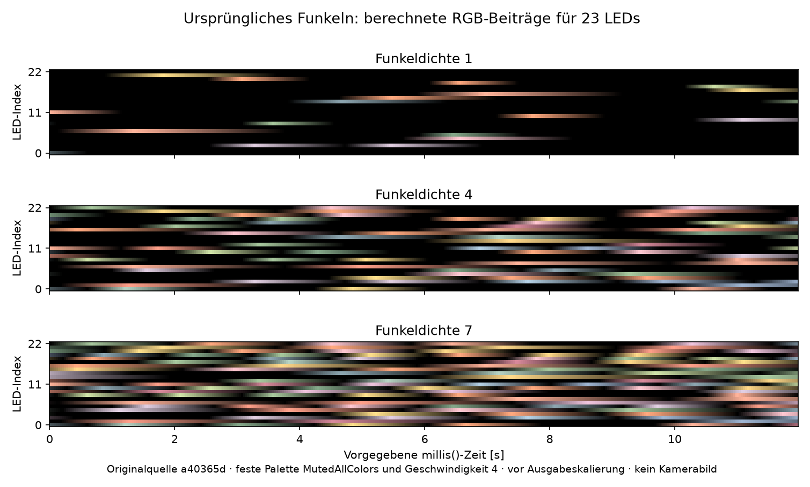

# Ursprüngliches Funkeln: Analyse und Vorbereitung der Kameraprüfung

Stand: **18. Oktober 2026**. Status: **Quellcodeanalyse und begrenzte
Rechnercharakterisierung belegt; kein Geräte- oder Kameralauf.**
Referenz ist derselbe benannte Live-Spielstand wie bei
[Wake-Ripple](legacy-wake-ripple-analysis.md) und [Burst](legacy-burst-analysis.md):
`a40365d715b2055ee23f767fa53b55ac25243437`. Untersucht sind dessen
`twinklefox.cpp/.h`, `Pallets.h`, Farbzuordnung, Spielaufrufe und Ausgabekontext.
Das damalige installierte Firmwarebinary wurde hier nicht zusätzlich nachgewiesen.

## Ergebnis: ein fortlaufender farbiger Grundeffekt

`MyTwinkleFox` ist eine Anpassung von TwinkleFOX. Alle 23 LEDs werden fortlaufend
neu berechnet. Jede besitzt eine feste eigene Zeitverschiebung, einen eigenen
Geschwindigkeitsfaktor und einen eigenen Salz-Wert für die Musterauswahl.
Dadurch erscheinen farbige Aufhellungen mit unterschiedlichen Phasen und
Dunkelpausen. Das Muster wirkt zufällig, ist aber aus Uhrzeit und Zustand
deterministisch berechnet. Ein Aufruf des globalen `randomSeed()` im Bonuszustand
ändert diesen internen Generator nicht.

Der Effekt bildet die unterste Lichtschicht: Er überschreibt alle 23 Pixel;
anschließend addiert die LED-Task Burst und vier Ripples. Das Spiel verändert
seine **Zieldichte**, **Zielgeschwindigkeit**, **Zielpalette** und die globale
Ausgabehelligkeit. Funkeln selbst besitzt in dieser Fassung keinen Start-/Stop-
Auftrag und kein automatisches Laufzeitende.

Die Grafik stammt aus der Originalberechnung auf dem Rechner, bei festem
Geschwindigkeitswert 4 und bereits angeglichener Palette `MutedAllColors`.
Sie zeigt Roh-RGB vor globaler Helligkeit und Ausgabe, keine Kamerabilder oder
vollständigen Spielzustandsübergänge.

Quellen: [Originalimplementierung](https://github.com/Sven401/Larp-Escape/blob/a40365d715b2055ee23f767fa53b55ac25243437/lib/LedFx/twinklefox.cpp#L7),
[Zeichenreihenfolge der LED-Task](https://github.com/Sven401/Larp-Escape/blob/a40365d715b2055ee23f767fa53b55ac25243437/src/main.cpp#L63).

## Einzelne Aufhellungen und ihre Zeitbasis

Bei jedem Zeichnen beginnt der 16-Bit-Generator wieder bei **11337** und
erzeugt mit `seed=seed*2053+1384` zwei Werte pro LED. Die 16-Bit-Verkürzung
gehört zum Algorithmus. Weil die Folge jedes Mal gleich beginnt, sind die
LED-Eigenschaften fest statt pro Frame neu zufällig.

Die Geschwindigkeitsfaktoren liegen für diese 23 LEDs tatsächlich zwischen
8/8 und 23/8. Jede LED erhält damit ihre eigene aus `millis()` abgeleitete
virtuelle Uhr. `computeOneTwinkle()` verkürzt diese auf 16-Bit-Ticks und
verwendet deren unteres Byte als Phase 0–255. Der übergebene
`DrawContext.now` wird für die Berechnung **nicht** benutzt.

| tatsächliche Geschwindigkeit | Grundzyklus in virtueller Zeit | ungefährer Grundzyklus der 23 LEDs |
| --- | ---: | ---: |
| 1 | 32768 ms | 11,40–32,77 s |
| 4 | 4096 ms | 1,42–4,10 s |

Das sind abgeleitete Grundzyklen einer möglichen Aufhellung. Die Dichteauswahl
kann ganze Zyklen auslassen; die komplette Farb-/Funkelfolge wiederholt sich
nicht schon nach dieser Zeit. Die LED-Task zeichnet nominal nach jeweils
33 ms Wartezeit erneut, der Musterfortschritt hängt dagegen von der globalen
Uhrzeit ab. Weniger Bilder machen die Bewegung gröber; sie frieren die
virtuellen Uhren nicht wie bei den framegezählten Ripples/Bursts ein.

Die interne Helligkeit steigt für Phase 0–85 in Dreierschritten und fällt
danach langsamer ab:

| Phase | 0 | 85 | 86 | 255 | nächste Phase 0 |
| --- | ---: | ---: | ---: | ---: | ---: |
| Helligkeit | 0 | 255 | 255 | 2 | 0 |

Damit liegt der Anstieg ungefähr im ersten Drittel und das Abklingen in den
übrigen zwei Dritteln. Es ist kein symmetrischer Sinuspuls. Die ermittelte
Farbe kommt über `ColorFromPalette(...,NOBLEND)`: Der Farbindex wählt einen
der 16 aktuellen Paletteneinträge, ohne zwischen benachbarten Einträgen zu
interpolieren. Zeitliche Annäherung der Palette ist trotzdem vorhanden.

## Was Funkeldichte bedeutet

Die aus langsamem Takt und LED-Salz berechnete Auswahl enthält acht Gruppen.
Ein Zyklus erhält eine Helligkeit, wenn seine Gruppennummer kleiner als die
aktuelle Dichte ist. Dichte 0 lässt keine eigentlichen Funkelpulse zu; Dichte 8
lässt alle Gruppen zu. Dazwischen wird ungefähr ein Anteil `Dichte/8` der
Gruppen zugelassen. Das ist **keine feste Zahl eingeschalteter LEDs**, keine
Helligkeitsskala und bei 23 LEDs kein exakt garantierter Prozentwert pro Bild.

In den getrennten Rechnerläufen mit stabiler Palette, Geschwindigkeit 4 und
364 Zeitpunkten von 0 bis 11979 ms waren beispielsweise rund 13,26 % der
LED-Zeitpunkte bei Dichte 1, 50,37 % bei Dichte 4 und 82,90 % bei Dichte 7
ungleich Schwarz. Das beschreibt ausschließlich dieses berechnete Zeitfenster;
es sind keine gemessenen Lichtanteile oder allgemeinen Abnahmeschwellen.

## Spielzustände und Sollwerte

| Eintritt | Zieldichte | Zielgeschwindigkeit | Zielpalette | globales Helligkeitsziel |
| --- | ---: | --- | --- | --- |
| Setup vor Start der LED-Task | 1 | 1 | nur **aktuelle** Palette auf Muted gesetzt | unmittelbar 100 |
| Standby | 0 | übernommen | übernommen | übernommen |
| Idle | 1 | übernommen | MutedAllColors | 20 |
| WaitingForCrystals | 2 | 4 | übernommen bis zu passendem Farbkristall | 50 |
| FirstCrystalPlaced | 3 | übernommen | nur durch passende Kristallerkennung geändert | 100 |
| SecondCrystalPlaced | 4 | übernommen | ebenso | 150 |
| ThirdCrystalPlaced | 5 | übernommen | ebenso | 200 |
| GameCompleted | 6 | übernommen | übernommen | 255 |
| ErrorState | 3 | übernommen | übernommen | übernommen |
| BonusState | 7 | übernommen | übernommen | übernommen |

„Übernommen“ ist absichtlich kein festes 1 oder 4. Nach WaitingForCrystals
bleibt das Geschwindigkeitsziel 4 auch bei späterem Idle/Standby erhalten.
Weder Standby noch `gameReset()` stellen alle Lichtparameter auf Bootwerte
zurück. Globale Helligkeit wird in den angegebenen Spielzuständen mit einem
Schritt je frühestens 150 ms angenähert. Sie ist vom Dichte-/Geschwindigkeitstimer
getrennt und skaliert später auch Burst und Ripple mit.

Die Farbanforderung erfolgt beim **neu angenommenen gültigen Kristall**, bevor
ein späterer Kristallzustand gegebenenfalls erst nach Audioende betreten wird.
Nicht jeder der drei richtigen Kristalle ändert die Palette:

| Rolle | zugehöriger Farbkristall | Palette |
| --- | --- | --- |
| Puppenspieler:in | E4 | Purple |
| Krieger:in | B6 | Red |
| Narr / Närrin | B9 | Orange |
| Abenteurer:in | E2 | Green |
| Überlebende:r | G7 | White |
| Wissende:r | G2 | Blue |

Für andere Rollen-/Positionskombinationen liefert die Zuordnung keine neue
Palette; das bisherige Ziel bleibt erhalten. Doppelt eingelesene, schon
erfasste Kristalle durchlaufen die Palette-Änderung nicht erneut.
White enthält selbst leicht getönte Farben. Yellow, Pink und Turquoise sind
zusätzlich in `Pallets.h` definiert, werden von dieser Spielzuordnung aber
nicht ausgewählt. Es gibt keinen aktivierten automatischen 30-Sekunden-
Palettenwechsel.

Quellen: [Spielaufträge und neue Kristalle](https://github.com/Sven401/Larp-Escape/blob/a40365d715b2055ee23f767fa53b55ac25243437/lib/GameState/GameState.cpp#L39),
[Farbzuordnung](https://github.com/Sven401/Larp-Escape/blob/a40365d715b2055ee23f767fa53b55ac25243437/lib/LedFx/CrystalPaletteMap.cpp#L9),
[Zielpalette und globale Rampe](https://github.com/Sven401/Larp-Escape/blob/a40365d715b2055ee23f767fa53b55ac25243437/lib/LedFx/GameLightEffects.cpp#L14).

## Übergänge sind eigene Teile des Erscheinungsbildes

Die Dichte-/Geschwindigkeitssetter ändern ausschließlich Zielwerte. Aktuelle
Werte nähern sich um **einen Schritt je ausgelöstem 1000-ms-Timer** an. Das
ist keine kontinuierliche Easing-Kurve, trotz des Kommentars im Original.
Von Geschwindigkeit 1 zu 4 werden nominell drei Schritte benötigt.

Die Timer sind statische lokale Timer an den drei Stellen der Zeichenfunktion,
keine frisch beim Zustandseintritt gestarteten Objekt-Timer. Beim erneuten
Zielwechsel kann der erste Schritt sofort stattfinden, wenn der alte Timer
bereits abgelaufen ist. Eine lange Pause holt mehrere Schritte nicht nach:
Die Probe von 0 auf 5000 ms führt nur zu einem Dichte- und Geschwindigkeitsschritt.
Geschwindigkeitsänderungen rechnen die globale Uhr mit einer anderen Bit-
Verschiebung um; eine phasenkontinuierliche Beschleunigung wird nicht zugesichert.

Paletten nähern sich durch `nblendPaletteTowardPalette(current,target,12)` an.
Die Zehn-Millisekunden-Abfrage kann bei einem Zeichnen ungefähr alle 33 ms nur
einmal pro Zeichnen auslösen. Sie holt verpasste Aktualisierungen nicht nach.
Die 12 sind ein Budget für unterschiedliche **RGB-Kanäle**, nicht zwölf
vollständig ausgetauschte Farben und keine Millisekunden. Ein steigender Kanal
wird um 1, ein fallender um bis zu 2 angenähert. Die Funktion läuft die
48 Kanäle ab Anfang durch; spätere Paletteneinträge können entsprechend später
beginnen. Eine feste Überblenddauer oder überall gleiche Übergangsquote gibt es nicht.

Ein Bootdetail ist dadurch sichtbar relevant: Der globale Effekt beginnt durch
statische Nullinitialisierung mit schwarzer **Zielpalette**. Setup setzt nur
`currentPalette=MutedAllColors`, nicht auch die Zielpalette. Die ersten
Palettenaktualisierungen bewegen die aktuelle Palette deshalb Richtung Schwarz.
Standby setzt zusätzlich die Funkeldichte Richtung 0. Erst Idle setzt Muted
ausdrücklich auch als Ziel. Eine Laborinitialisierung mit beiden Paletten auf
Muted wäre ein stabiler Diagnoselauf, aber keine originalgetreue Bootfolge.

## Hintergrund und irreführende Header-Schalter

Der Konstruktor setzt tatsächlich Geschwindigkeit/Dichte 1/1,
`coolLikeIncandescent=false` und `autoSelectBackgroundColor=true`. Die
Header-Defines `TWINKLE_SPEED=4`, `TWINKLE_DENSITY=5`,
`COOL_LIKE_INCANDESCENT=1`, `AUTO_SELECT_BACKGROUND_COLOR=0` und
`SECONDS_PER_PALETTE=30` werden dafür nicht benutzt. Eine Wiederaufnahme
allein nach diesen Defines würde falsche Laufzeitwerte herstellen.

Wenn die ersten zwei **aktuellen** Paletteneinträge gleich sind, kann ihr
gedimmter erster Farbwert automatisch zum Hintergrund werden. Bei Dichte 0
gibt es dann zwar keine Funkelpulse, aber weiter Hintergrundlicht. Mit einer
gleichmäßig weißen Diagnosepalette ergibt die Rechnerprobe `(16,16,16)` auf
allen LEDs. Bei ausgeschalteter Automatik wird derselbe Fall schwarz.
Mit der stabilen Muted-Palette ist Dichte 0 schwarz. Diese Diagnosepalette
ist ein gezielter Randfall und keine zusätzliche Spielfarbzuordnung.

Bei vorhandenem Hintergrund wählt die Funktion abhängig vom Helligkeitsabstand
Funkelfarbe, eine Mischung oder Hintergrund. Das im Code vorhandene rötliche
Glühlampen-Nachglühen wird im Originalbetrieb dagegen nicht verwendet, weil
der zugehörige Laufzeitschalter auf false steht.

Quelle: [Konstruktor, Annäherung und Hintergrund](https://github.com/Sven401/Larp-Escape/blob/a40365d715b2055ee23f767fa53b55ac25243437/lib/LedFx/twinklefox.cpp#L9).

## Vergleich und vorbereitete Kamerafälle

Die heute vorhandene `lib/LedFx/twinklefox.cpp/.h` ist am untersuchten aktuellen
Arbeitsstand in diesen Dateien unverändert gegenüber `a40365d`. Ihre heutige
Einbindung und Ausgabe sind damit nicht ebenfalls als historisch abgenommen.
Der heutige **manuelle** Funkel-Effekt in `firmware/led/src/LedOutput.cpp` ist
eine andere Implementierung: weiße, kubisch zugespitzte Dreieckspulse mit
Perioden 490–1190 ms und Grundhelligkeit 4 bei voller Intensität, ohne die
ursprünglichen Paletten-/Dichtemechanismen. Sein Kamerabefund ersetzt den
Originalvergleich nicht.

| Fall | Umfang | erwarteter Nachweis |
| --- | --- | --- |
| T1 | Originaler Boot und erster Standby | aktuelle Muted-Palette, zunächst schwarzes Ziel, Absenken der Dichte; von vollständig initialisiertem Diagnoselauf unterscheiden |
| T2 | Stabile Geschwindigkeiten 1 und 4, mehrere Dichten | eigene LED-Phasen, schnelle Anstiege/langsames Abklingen, ausgelassene Zyklen und echte Dunkelpausen |
| T3 | Zustandsfolge Standby/Idle/Waiting/Kristalle/Abschluss/Fehler/Bonus | aktuelle und angeforderte Werte, erste Timerschritte und globale Helligkeit getrennt protokollieren |
| T4 | Rückkehr von hoher Dichte/Tempo nach Idle und Standby | Absenkung, weitergeführte Geschwindigkeit und übernommene Palette; kein erfundener Bootreset |
| T5 | Alle sechs Farbkristalle plus andere gültige Kristalle | richtige Zielpalette nur bei zugehöriger Rolle/Position; RGB-Morph und dessen Reihenfolge sichtbar erfassen |
| T6 | Dichte 0 mit normaler und automatisch hinterlegter Palette | Funkelpulse aus versus vollständige Dunkelheit getrennt prüfen |
| T7 | Zeichenpause, Wiederaufnahme und verschiedene Uptime | Musterphase aus millis(), fehlendes Nachholen der Regler/Palette und uint16-/uint32-Arithmetik erhalten |
| T8 | Kombination mit Original-Burst und sicheren Ripple-Fällen | Funkeln überschreibt zuerst vollständig; spätere additive Beiträge und Rückkehr zum Hintergrund abgleichen |
| T9 | Ausgabe und optische Messmittel | globale Rampe/Farbkorrektur/Leistungsbudget, eigene Farb-/Helligkeitsreferenzen und ausgegebene RGB-Spur nachweisen |

Für den späteren Originaltest müssen Uhrzeit, aktuelle/gewünschte Werte,
aktuelle/Zielpalette, Zeichenfolge und tatsächliche Ausgabeframes erhalten
bleiben. Ein vergleichbares Zeitfenster entsteht nicht allein durch einen
neuen Startknopf: Die ursprünglichen Phasen hängen an `millis()`, während
Regler und Palette auch von ihrer bisherigen Zeichen-/Timerhistorie abhängen.

Die langsame Bootgeschwindigkeit kann Grundzyklen über 30 Sekunden erzeugen,
zusätzlich zur Auslassung durch geringe Dichte. Beobachtungsfenster und die
bisherigen Labor-Zeitgrenzen müssen dafür bewusst geplant werden. Eine dunkle
LED im kurzen Ausschnitt ist allein kein Ausfallnachweis. Indexkalibrierung
muss mit gezielten Einzellichtern vor dem Funkeln erfolgen. Die gebrauchten
Farb-/Helligkeitsfamilien benötigen eigene unabhängige optische Referenzen;
die alten Weiß-/Cool-/Blau-Cyan-LUTs sind dafür kein pauschaler Ersatz.

Die beschriebenen Spielparameter werden historisch ohne gemeinsames
Synchronisationspaket mit der LED-Task geteilt. Die Rechnerprobe belegt keine
deterministische ESP32-Taskordnung. Labor-Stop/Watchdog sind zusätzliche
Messsteuerung und kein ursprünglicher Start-/Stop-Vertrag des Funkelns.

## Bisheriger Prüfstand

[Maschinenlesbare Befunde, LED-Zeitparameter und Quellfingerabdrücke](fixtures/legacy-twinkle-characterization-2026-10-18.json).
Acht gezielte Rechnerfälle bestanden: Start, Timer, Pause, Palettenannäherung,
Hintergrund, Determinismus/Uhr/Pufferüberschreibung, Hüllkurve und Farbzuordnung.
Die Zuordnung prüft 486 Rollen-/Koordinatenkombinationen mit sechs Farbtreffern.
Zusätzlich wurden für alle neun stabilen Dichten 0–8 je 364 Frames mit 23 LEDs
berechnet, zusammen **75348 LED-RGB-Zeitpunkte**, jeweils bei Geschwindigkeit 4
und MutedAllColors. Weitere sechs Paletten wurden nicht als vollständige
RGB-Zeitspuren durchgemessen; ihre Auswahl ist quell- und hostseitig bestätigt.

`twinklefox.cpp`, die Paletten und die Farbzuordnung wurden unverändert aus
dem Referenzcommit übernommen. Der historische Header erhielt nur öffentlichen
Messzugriff statt privater Sichtbarkeit. Ein begrenzter Fx-/CRGB-/Uhr-/Timer-
Adapter und aus der lokal vorliegenden FastLED-Version 3.10.5 extrahierte
Hilfsfunktionen ersetzen den vollständigen Bibliotheks-/Gerätebetrieb.
Fixed-scale8 und der ESP32-Standardpfad der Hintergrundmischung sind dabei
gesetzt. Kein echter Ausgabetreiber, vollständiger Spielablauf, elektrische
Messung oder Kameratest. Der Build enthält eine bestehende Warnung zum
mehrzeiligen ASCII-Kommentar im Originalheader, keinen Compilerfehler.

Editierbare Probe und Rohspuren im Testcheckout: `private/legacy-twinkle-analysis`
mit `HERKUNFT.md`, `run.py`, `probe.cpp`, Adapterheadern, unveränderten Original-
dateien, `extracted-fastled.cpp`, neun `density-*.csv`, Fall-/Buildlogs,
`characterization.json` und `plot.py`. Dieses einmalige Prüfmittel wird nicht
als dauerhafter Projektstandard übernommen. Produktcode und installierter
Boxstand bleiben in dieser Analyse unverändert.
