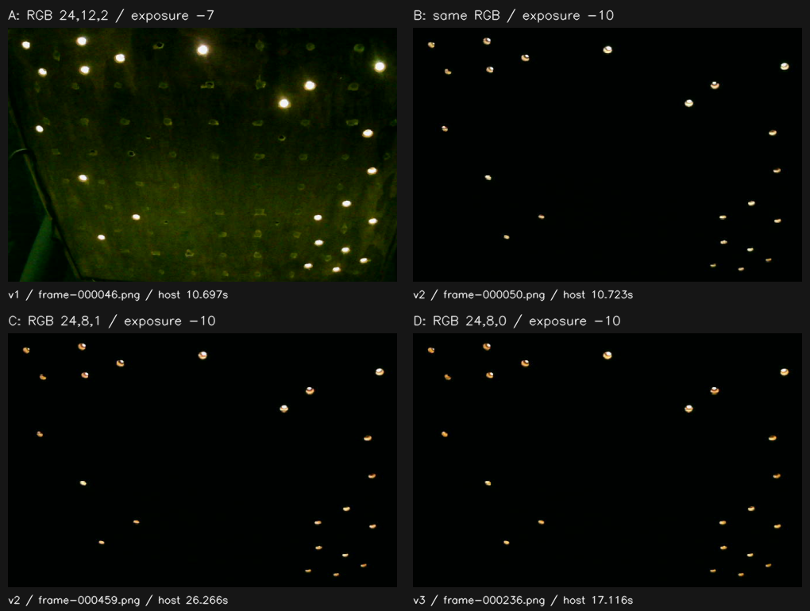
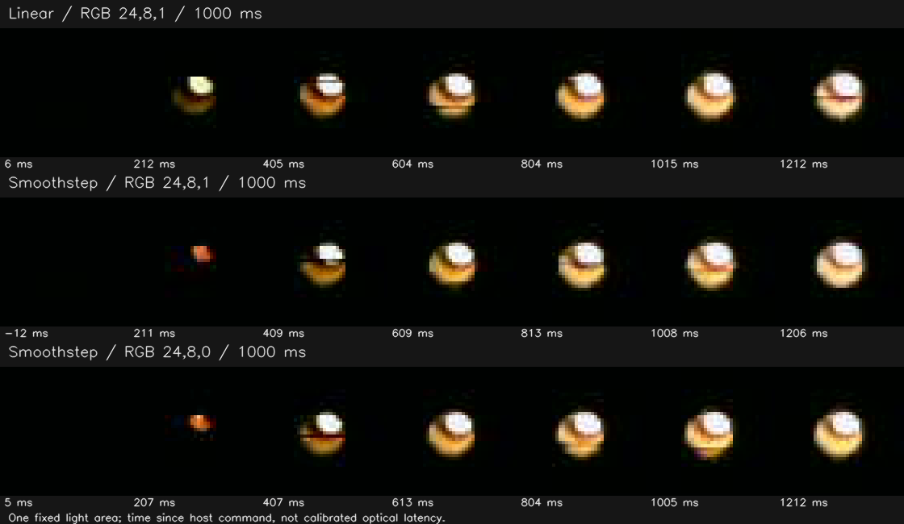
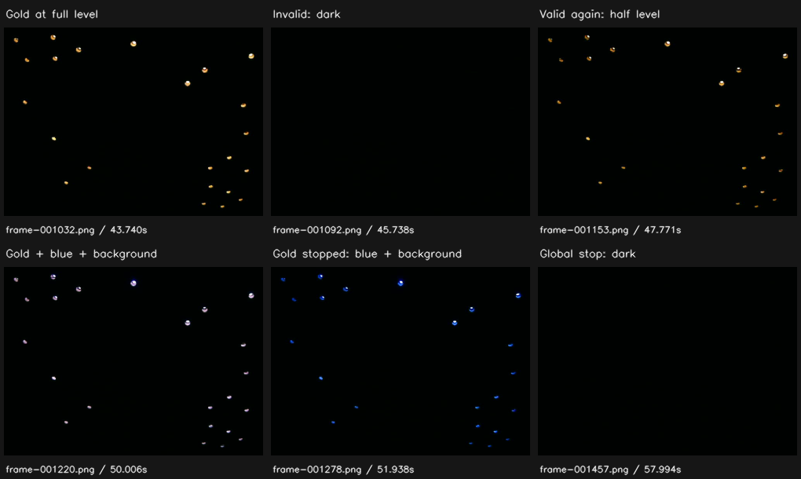

# Näheglut: frühe Lichtversuche und überarbeitete Architektenrolle

Stand: **18. Oktober 2026**. **Praktisch erprobter Laborprototyp und Rollenfassung 2.0**.
Kein abgenommenes Gesamtspiel. Der erweiterte Nutzerauftrag in Sitzung
`01a14f9a-35fb-72e1-9acb-132b0d16599d` beauftragt ausdrücklich Implementierung,
serielle Parameterentwicklung und paralleles Kamerafeedback. Er ersetzt die
frühere Beschränkung auf Entwurf und Prüfplanung.

## Ergebnis und Abgrenzung

Die [Rolle](rollen/led-effekt-architekt.md) begleitet nun die gesamte Entwicklung.
Der [direkte Versuchsweg](interactive-development.md) ist implementiert und an
echten LEDs angewandt: ein Firmwareupload, danach drei Kameraläufe mit Änderungen
von Farbe, Gain, Kurve, Pegel und Gültigkeit über dieselbe serielle Verbindung.
Zwei unabhängige Instanzen und Hintergrund lassen sich mischen und gezielt stoppen.
Der hardwarefreie [C++-Kern](../../firmware/led/src/NearGlow.cpp) ist zugleich der
im Labor ausgeführte Kern; es gibt keine zweite Kamera-Effektimplementierung.

**Tragfähige Arbeitsvariante:** RGB `(24,8,0)`, Gain 1000, Smoothstep über 1000 ms,
alle 23 LEDs gemeinsam; p=0 dunkel, p=1000 maximaler Beitrag. Diese Auswahl ist
ein gestalterischer Vorschlag nach Kamerafeedback, keine vom Nutzer erteilte
Farb-/Helligkeitsabnahme. Die bestätigte Absicht bleibt warmes Gold und etwa eine
Sekunde. Der erste rötliche Helligkeitsschritt und die grobe Abstufung im Dunkeln
bleiben sichtbar bzw. technisch erwartbar; Dithering oder Gamma wurden nicht eingeführt.

Spielquelle, konkrete Spielsituation und Sensorbewertung fehlen weiterhin.
Der Versuch speist bewusst synthetische normalisierte Werte ein. Ein Produktadapter,
neue BLE-IDs, App-Bedienung und autonome Spielereignisse wurden nicht erfunden.
Die Rolle umfasst diese Integration, sobald die erforderlichen Produktentscheidungen
vorliegen. Der aktuelle Nachweis reicht bis zum praktisch verfeinerten Laborprototyp.

## Grundlage, Gerät und Rückweg

- Arbeitsbasis `aa887f56c428f02a4adbad55e1e0fea78e09f12f` auf
  `dead12040c196ff74ab4be17ba71451a9351a676`; eigener Branch
  `codex/led-effekt-architekt`, PR #74. Originalanalysen aus PR #71 bleiben bei
  `e7ec0f94de8abdc525e7cf5bdf7e049831dc7782` gepinnt. Der Quellenrouter der Rolle
  nutzt diese Analysen gezielt; kein Übernehmen des Resonanzkreis-Branches nötig.
- Vor Upload MAC `a8:42:e3:cd:4b:18`, 4 MiB, Partitionen und frische Sicherung am
  Chip geprüft. Sicherung SHA-256
  `b703f4b13aaaaa3e8c3bc68d8e8134b1cec0a77df957ea06175ac147d1d03c71`.
  Nur Anwendung ab `0x10000` geschrieben; Boot-/Partitions- und Schlüsselbereich
  nachgelesen und unverändert. Keine privaten Flashabbilder im Repository.
- Laborbinary SHA-256
  `6cd465a1bf5c414e2aca0dca142cd0410f38b1c1a3738bae723cdb98e29b9e36`.
  Alle drei Läufe prüften Größe/MD5 des installierten Sketches und dokumentierten
  denselben SHA-256. Firmwarequellen vor Upload fingerprinted; der Hostfix zwischen
  v1 und v2 erforderte keinen Firmwarebuild oder Upload.
- HD Webcam USB, DirectShow, 1280×720 MJPG, 30 fps angefordert. Andere Kamera-App
  zunächst blockierend; nach Nutzerbestätigung geschlossen und Bilder verfügbar.
  Gain 0, Weißabgleichautomatik aus, Belichtung zunächst −7, danach −10.
  Soll-/Rücklesewerte stehen im Datensatz. Auto-Exposure-Getter −1 ist kein
  Nachweis eines tatsächlichen Automatikzustands; Grenzen aus dem
  [Kameraverfahren](camera-measurement.md) gelten weiterhin.
- **Nach den Versuchen Originalanwendung wiederhergestellt**, App verifiziert,
  vollständige 4 MiB gegen die frische Sicherung verifiziert, Boot-/Schlüsselbereich
  unverändert und ursprüngliche Bereitschaftsmeldung beobachtet.

Private Rohdaten, ELF, Binary und Installations-/Rückwegprotokolle liegen unter
`C:\Dev\Larp Escape\private\led-live-20261018`. Öffentliche Auszüge,
Quellfingerabdrücke und private Manifest-Hashes:
[summary.json](probes/naeheglut/live/summary.json).
Der versionierte Paketcommit enthält die geprüften Quellinhalte; die frühe
Geräteprobe fand bewusst vor dem Commit statt.

## Tatsächlicher Iterationslauf

| Schritt | Beobachtung | Daraus folgende Änderung und Ergebnis |
| --- | --- | --- |
| v1: RGB 24/12/2, linear, 1000 ms, Gain 1000 | Alle Lichtflächen gemeinsam sichtbar; Kerne im Kamerabild überwiegend weiß. | Während Aufnahme Gain auf 350 gesetzt. Kerne blieben teilweise weiß; reduzierte Helligkeit allein löste den Farbvergleich nicht. |
| v1: laufende Vorschau betrachtet | Windows sperrte `latest.png` kurz; Austausch erzeugte WinError 5 und Kameraabbruch. | Lauf korrekt `incomplete`, frischer Schwarzframe und DONE bestätigt. Vorschau wird jetzt bei Sperre mit Warnung übersprungen; unveränderte Aufnahmebilder und Lebenszeichen laufen weiter. Erst gezielte Regression, dann neuer Versuch. |
| v2: gleicher Ausgangseffekt, Belichtung −10 | Dunkler Hintergrund, kleinere weiße Kerne, gelblicher Rand besser erkennbar. Weiter lokale Sättigung. | Bei gleicher Belichtung RGB auf 24/8/1 geändert. Im Vergleich wärmerer orangegoldener Rand; als gestalterische Richtung beibehalten. Keine absolute Farbmessung. |
| v2: Rampe ab null, linear und Smoothstep, je 1000 ms | Linear ist bei etwa 0,2 s bereits deutlicher sichtbar; Smoothstep beginnt zurückhaltender. Beide erreichen ein ruhiges Plateau. | Smoothstep für die beabsichtigte ruhige Wirkung weiterverwendet. Keine Aussage, dass alle Helligkeitsstufen unsichtbar wären. |
| v3: Kandidat wiederholt, Blau von 1 auf 0 | Die warmgoldene Wirkung bleibt im Kamerabild erhalten. Bei B=1 wird Blau rechnerisch erst am vollen Endpunkt ausgegeben; das Kamerabild allein beweist dessen Anteil am hellen Kern nicht. | RGB 24/8/0 beseitigt diesen späten diskreten Blau-Schritt. Erneute Auf-/Abblendung aufgenommen; als Arbeitsvariante festgehalten. |
| v3: ungültig, Wiederkehr, Überlagerung, gezielter Stop | Gold verschwindet bei ungültigem Wert, kehrt mit halbem Wert zurück; nach Gold-Stop bleiben Blau und Hintergrund sichtbar. | Lebenszyklus und Mischung auf dem realen Ausgabepfad nachvollzogen. Wiederholter Stop verlängert nicht, Update nach Ende wird abgelehnt, neue Generation kann starten. |



Die erste Zeile ändert die Aufnahmebedingung; sie ist kein kontrollierter
Farbvergleich. B→C und C→D verwenden gleiche angeforderte Kameraeinstellungen.
Bilder sind Ausschnitte unveränderter PNGs, ohne Farb- oder Helligkeitskorrektur.



Ausschnitt einer festen Lichtfläche, zur Sichtbarkeit pixelgetreu vergrößert.
Zeiten sind Kameraempfang relativ zum Sendebeginn des Hostbefehls. Sie enthalten
USB-/Kamerapufferung; negative Werte kennzeichnen das letzte Bild vor dem Befehl.
Das ist gestalterisches Feedback, keine kalibrierte Lichtlatenzmessung.



## Berechnung und digitaler Gerätenachweis

Vollständiger [Rechen-/Protokollvertrag](../../firmware/led/LIVE-NEARGLOW.md);
der [Entwurf](naeheglut-design.md) erhält auch das historische skalare Modell.
Aktuell interpoliert jeder Kanal seinen unquantisierten Festkommawert mit
Q=1.000.000. Ziel `C*Q*p*gain/1.000.000`, bei ungültig null. Mit
`u=min(elapsed,D)/D` gilt linear `w=u`, Smoothstep `w=3u²−2u³`.
Erst beim Rendern erfolgt Abrunden auf RGB8, danach breite Addition mit anderen
Beiträgen und Begrenzung auf 32. Das ist keine lineare optische Helligkeitsskala.

Unabhängig nachrechenbare Sollpunkte für die Arbeitsvariante ab null bei p=1000:

| Zeit | Smoothstep-Gewicht | RGB8 24/8/0 |
| --- | --- | --- |
| 0 ms | 0 | (0,0,0) |
| 250 ms | 0,15625 | (3,1,0) |
| 500 ms | 0,5 | (12,4,0) |
| 750 ms | 0,84375 | (20,6,0) |
| 1000 ms | 1 | (24,8,0) |

Bei p=500 ist der Endwert `(12,4,0)`. Plus blauem Beitrag `(0,0,8)` und
Hintergrund `(2,2,2)` ergibt das `(14,6,10)`. Ein Gold-Stop führt nach Ausblenden
zu `(2,2,10)`, nicht zu Schwarz. Genau diese Werte erscheinen in v3 im echten
TX_DONE-Trace für alle 23 LEDs.

Weitere tatsächlich geprüfte v3-Fälle:

- Ungültig bei Gerätezeit 441509 ms; erneutes ungültiges p nach 523 ms verlängert
  nicht: bei ursprünglichem +1002 ms ist der Beitrag null.
- Gold-Stop bei 447590 ms; Wiederholstop nach 330 ms. Nach ursprünglichem
  +1006 ms verbleibt `(2,2,10)`. Auftrag 12 wird mit `lifecycle` abgewiesen.
- Neue Generation 2 startet; Ziel während Anstieg nach 264 ms und 576 ms geändert.
  Das belegt Neuansetzen einer laufenden Rampe. Das Kommandoetikett
  `reverse-target` belegt keinen Richtungswechsel: der aktuelle Beitrag lag noch
  unter dem Zwischenziel. Keine gegenteilige Erfolgsbehauptung.
- Nur Blau stoppen lässt `(26,10,2)`, Hintergrund entfernen ergibt `(24,8,0)`.
  Gesamtstop erzeugt frische 23×Schwarz-Ausgabe und danach DONE.

## Erreichbare Reaktion und Kameragrenzen

25 protokollierte Aufträge über alle Läufe: 24 APPLIED, eine beabsichtigte Ablehnung.
3666 digital bestätigte Frames, je Lauf fortlaufende Sequenz; alle 23 Pixel jedes
Frames identisch, tatsächlicher Höchstkanal 26. Höhere Mischsättigung wird durch
Softwaretests geprüft, nicht durch diese Geräteprobe.

| Host-/Gerätemessung | Minimum / Median / Maximum |
| --- | --- |
| Sendebeginn → ACK, alle 25 Aufträge | 12,407 / 14,719 / 26,244 ms |
| Übernahme → erste zugeordnete Frame-Einreichung, 24 APPLIED | 11 / 11,5 / 31 ms |
| Übernahme → erster zugeordneter TX_DONE | 12 / 13,5 / 33 ms |
| Sendebeginn → Empfang dieses TX-Ereignisses | 35,551 / 44,041 / 58,961 ms |

STOP-Sendebeginn → tatsächlicher DONE-Empfang: v1 **32,900 ms**, v2 **31,036 ms**,
v3 **34,081 ms**. Das sind beobachtete Hostzeiten, keine garantierten Obergrenzen.
Der erste zugeordnete Frame kann wegen einer kleinen Anfangsänderung noch dieselben
RGB8-Werte enthalten. ACK, übertragene Einstellung und sichtbare Reaktion trennen.

| Lauf | Status | Kamerabilder / TX-Frames | Kamerarate | größte Empfangslücke |
| --- | --- | --- | --- | --- |
| v1 | incomplete, Vorschaufehler | 672 / 843 | kein gültiger Abschlussbericht | nicht als Abnahme verwenden |
| v2 | recorded | 1266 / 1341 | 28,274 fps | 144,666 ms, zweimal >100 ms |
| v3 | recorded | 1463 / 1482 | 29,601 fps | 61,891 ms, keine >100 ms |

Kein verworfenes Bild wegen Schreibstau. In v2 wurde eine blockierte Vorschau
bereits toleriert und als Warnung gespeichert; der Lauf blieb vollständig.
`recorded` bedeutet vollständig aufgezeichnet, nicht optisch bestanden.
Lokale Sättigung bleibt auch bei Belichtung −10 bestehen, die Kamera hat einen
Farbstich und liefert MJPG statt Sensor-RAW. Reihen-/PWM-Artefakte, Belichtung,
Bildrate und unbekannte Pufferzeiten verhindern eine Aussage über jedes einzelne
LED-Frame, Flimmerfreiheit, exakte Lichtfarbe oder harte Echtzeit. Es wurde keine
neue Index-/Farbkalibrierung durchgeführt. Für diesen frühen Gestaltungsvergleich
genügen die sichtbaren Flächen; metrische Abnahme braucht zusätzliche Referenzen.

## Softwareprüfung und Bewertung der Rolle

Vor dem ersten Upload: gezielte Laborschleifen-/Kern- und Hostprüfungen, passender
Laborbuild. RAM 24452 B, Flash 283201 B. Nach dem ersten praktischen Fehler:
Vorschau- und Abschlussregression; erst danach weiter aufgenommen. Nach tragfähiger
Variante: 20 Kamera-Hosttests, 9 echte C++-Laborschleifenfälle und 7 Kernprüfgruppen
mit 2002 Pegel-/Kurven-Unterfällen bestanden. Bestehende Ausgabe-, RMT-, Wake-,
I2C- und Matrixtests ebenfalls bestanden. Alle vier getrennten Produktvarianten erfolgreich gebaut:

| Variante | RAM / Flash in Byte |
| --- | --- |
| LED | 42512 / 1136045 |
| NFC | 47272 / 1147193 |
| ESP-NOW | 59472 / 1491489 |
| Matrix | 42560 / 1138153 |

Einzige beobachtete Compilerwarnung: bestehendes Arduino-Framework
`esp32-hal-uart.c:153` (Rückgabe ohne Wert). Keine Projektfehler. Die neuen Dateien
liegen außerhalb der bestehenden Architektur-/Header-/Format-Baselines; deren
unbeteiligte Gesamtsuiten wurden nicht wiederholt. [Softwareprüfzusammenfassung](probes/naeheglut/live/software-verification.json)
mit Loghashes ist versioniert; vollständige Prüfprotokolle und
Quellenfingerabdrücke liegen privat unter `verification/`. Softwaretests und
Produktbuilds verwendeten keine Kamera oder Hardware.

Unabhängiger Review fand zusätzlich einen Abschlussfehler: ein beim Zeitende
offener Auftrag konnte ohne Resultat als aufgezeichnet gelten. Der Abschluss
verarbeitet jetzt spätes ACK plus STATE; ungelöste Aufträge erhalten UNRESOLVED
und der Lauf bleibt incomplete. Fehlerpfade gerätefrei geprüft. Ein Foto-/Preview-
Lock und ein unbestätigter Auftrag dürfen keine falsche Erfolgsbehauptung erzeugen.

**Nutzungsbewertung:** Die Rolle hilft in dieser Anwendung konkret, weil das reale
Bild die Belichtung, Farbe und Kurvenwahl beeinflusste und der frühe Lauf einen
Workflowfehler sichtbar machte. Die ursprüngliche Rolle 1.0 hätte diesen Kreislauf
ausgeschlossen und erfüllte die erweiterte Erwartung nicht. Fassung 2.0 verlangt
deshalb den frühen gemeinsamen Effektkern, interaktive Zustands-/Framezuordnung,
beobachtungsbegründete Änderungen und drei getrennte Urteilsebenen. Daraus folgt
noch keine gemessene langfristige Zeitersparnis. Übernahme und einfacher Rückweg
stehen in [PROMOTION](../../PROMOTION.md).

## Verbleibende Entscheidungen und spätere Produktprüfungen

1. Nutzerurteil zum Licht vor Ort: warmes Gold, Maximalhelligkeit, rote erste
   Stufen, Tempo und ruhige Wirkung. Kameraauswahl ist keine menschliche Abnahme.
2. Spielsituation, Quelle des Nähewerts, Normalisierung und Frische festlegen;
   ungültig muss vom Spiel bewertet werden. Keine RSSI-zu-Meter-Annahme und kein
   ungefragter 20%-Fallback des bestehenden Funkelpfads.
3. Produktbesitzer/Adapter mit Epochen-/Generationssperre, atomarer Auftragsannahme,
   Fehler-/Überlastantwort, Pause, Profilbarriere und Ende implementieren und prüfen.
   `Scene::reset()` allein sperrt keine alten Produktaufträge. Im Labor übernimmt
   diese Grenze die inaktive Session mit neuem Token. Zwei feste Laborplätze
   behaupten keine unbegrenzte parallele Produktkapazität.
4. Mischregeln mit weiteren Effekttypen, Masken und gewollter Priorität fachlich
   abnehmen. ADD32 ist der jetzt ausführbare Versuch, kein ungeprüfter Ersatz für
   alle Originalmischungen. Lifecycle und Autonomie gegen BLE-Abbruch prüfen.
5. Passende Produkt-/App-Paare, Ressourcen und Dauerlauf unter realem Spielbetrieb
   prüfen; bei optischen Zahlen erst neue Farbe/Belichtung/Indexzuordnung passend
   kalibrieren. Versorgung und elektrische Signalqualität separat prüfen.

Reproduktion der abgeleiteten Bilder und JSON-Auszüge ohne Gerät:

```powershell
python docs/led/probes/naeheglut/collect_live_evidence.py --raw 'C:/Dev/Larp Escape/private/led-live-20261018' --output 'private/led-live-reproduction'
```

Das Auswerteskript prüft die ausgewählten Bildhashes, erzeugt die beschrifteten
Ausschnitte und liest die tatsächlichen Auftrags-/Framebelege. Rohbilder bleiben
privat; aus öffentlichen Auszügen kann kein vollständiger Flash rekonstruiert werden.
