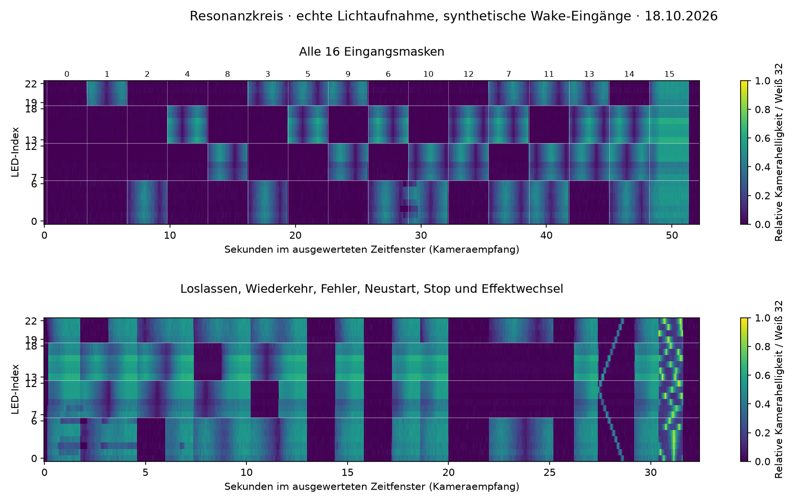

# Resonanzkreis: selbständiger Kameralauf · 18. Oktober 2026

**Belegt:** optische Laborprüfung mit synthetischen Wake-Beobachtungen auf der
realen Box. Alle 23 LEDs bestehen alle vier gewerteten Aufnahmen. Keine
Produktpaar-, Sensor- oder Gesamtspielabnahme.

Quellen-/Prüfstand: `e9790d85372422bfa4a8f6fc6b9e11d5e4f2c380`, aufbauend auf
`5d0cbab52171f13be4e82312e38d84e884c76400`, PR [#71](https://github.com/Sven401/Larp-Escape/pull/71).
Die Aufnahmen entstanden vor dem Quellencommit; ihre Quelldatei-SHA-256 wurden
anschließend gegen genau dessen unveränderte Arbeitsdateien abgeglichen.
`LedOutput.cpp` und `RmtLedBus.cpp` blieben gegenüber der bisherigen
Produktumsetzung unverändert. Erweitert wurden ausschließlich Laborsteuerung,
Aufnahme, Auswertung und zugehörige Tests/Dokumentation.

[Messverfahren und Wiederholung](resonance-camera-measurement.md) ·
[Maschinenlesbare Ergebnisse, Quellfingerabdrücke und Indexkarte](fixtures/resonance-camera-results-2026-10-18.json) ·
[Weiterer Produkt-Prüfplan](resonance-test-preparation.md).

## Optischer Befund

Die erste Zeile enthält alle 16 Masken, jeweils 3,2 Sekunden. Null ergibt
Dunkelheit; einzelne Eingänge und Zweier-/Dreierkombinationen lassen genau
ihre Bereiche atmen. Bei Maske 15 geht der gesamte Streifen in das gemeinsame
Leuchten über. Die zweite Zeile zeigt Loslassen und Wiederkehr jedes der vier
Eingänge, ungültigen Lesestand und ungültige Maske mit Dunkelheit, Erholung,
bewussten Neustart, Stop im gemeinsamen Leuchten und beim Atmen, Eingangswechsel
nach Stop sowie Wechsel zu Ripple und Funkeln. Die gemeinsame Farbe nach der
Zusammenführung ist im bestätigten Ausgabestrom `(4,16,24)`; das optische Signal
folgt diesem Verlauf. Unterschiedliche Kamerahelligkeiten zwischen LEDs sind
keine unterschiedlichen ausgegebenen RGB-Werte.

| Gewertete Aufnahme | Bilder | Eingangsschritte | kleinste LED-Korrelation | größter mittlerer RGB-Fehler | größter Dunkelrest | größte Bildlücke |
| --- | ---: | ---: | ---: | ---: | ---: | ---: |
| Alle Masken (`masks-02`) | 1700 | 16 | 0,9473 | 3,03 % | 2,78 % | 59,49 ms |
| Übergänge (`transitions`) | 1106 | 22 | 0,9425 | 4,02 % | 3,52 % | 59,01 ms |
| Ausdrücklicher USB-Stop (`host-stop`) | 206 | 1 | 0,9666 | 7,96 % | 2,65 % | 63,88 ms |
| Ausbleibendes USB-KEEP (`watchdog`) | 220 | 2 | 0,9967 | 2,50 % | 3,19 % | 47,82 ms |

Fehler und Dunkelrest beziehen sich pro LED auf die unabhängig gemessene
Weiß-32-Referenz. Alle 23 LEDs erfüllen jeweils die vorab festgelegten Grenzen:
Korrelation ≥0,90; mittlerer Fehler ≤12 %; 95. Fehlerperzentil ≤25 %;
Dunkelrest ≤5 %; keine gesättigten Messpixel. Das größte 95. Fehlerperzentil
aller vier Aufnahmen beträgt 23,02 %. Kein nachträgliches Anpassen der Grenzen.
Der Verlauf wird mit drei Bildern geglättet; Zeitversatz und Unterschiede
zwischen LEDs stammen ausschließlich aus den unabhängigen optischen Markern.

Die beiden separaten Abschaltläufe bestätigen tatsächliches Erlöschen nach
Host-Stop beziehungsweise Labor-Watchdog, jeweils mit übertragenem finalem
Schwarzframe und optischem Nachlauf. Der Watchdog ist **kein BLE-Trennnachweis**.
Der Übergangslauf belegt zusätzlich den Stop beim Atmen sowie dass ein danach
geänderter Eingang allein kein neues Licht startet.

## Kalibrierung, Vollständigkeit und Ausschluss

- Aktuell neu erfasste Aufnahmeflächen und Indexzuordnung: alle 23 LEDs
  einzeln, anschließend umgekehrte Prüfreihenfolge bei anderer Helligkeit;
  1309 Kalibrierbilder, maximal 73,79 ms Bildempfangslücke.
- Eigene direkte Blau-/Cyan-Farbreferenz für `(B/6,2B/3,B)` bei
  1/2/4/8/16/24/32, getrennt vom Resonanzkreis-Effekt; 290 Bilder.
- Kamera: DirectShow, OpenCV 4.13.0, 1280×720 MJPG, rund 30 Bilder/s,
  Belichtung −7, Gain 0, Gamma 100, Weißabgleich-Automatik 0. Einstellungen
  zwischen Kalibrierung und Läufen exakt zurückgelesen gleich. Auto-Exposure
  meldet trotz akzeptierter Abschaltanforderung −1; die eindeutige Abschaltung
  der Belichtungsautomatik ist daraus nicht bewiesen.
- Vier gewertete Läufe enthalten 3232 Messbilder. Einschließlich Pilot,
  Kalibrierung, Farbreferenz und ausgeschlossenem Erstlauf bleiben 6569
  Messbilder plus 220 Kontextbilder erhalten. Alle **6789 Bilddateien** wurden
  gegen ihre Aufnahme-SHA-256 geprüft; ebenso Frame- und Wake-Ereignisspuren.
- Der erste Maskenlauf (`masks`, ebenfalls 1700 Bilder) hatte eine maximale
  Bildempfangslücke von 85,8035 ms und überschritt die vorab festgelegten 80 ms.
  **Ausgeschlossen, kein bestandener Messlauf.** Vollständige Rohbelege erhalten;
  die vollständig neu aufgenommene Wiederholung `masks-02` erfüllt die Grenze.

## Chip, temporäre Installation und verifizierter Rückweg

Box am aktuellen COM3 als ESP32 mit MAC `A8:42:E3:CD:4B:18` und 4 MiB Flash
identifiziert. Vor Upload neuer vollständiger Abzug und `verify_flash` gegen
den Chip; Partitionen und Schlüsselbereich gegen den erhaltenen historischen
Rückweg abgeglichen. Nur die Anwendung ab `0x10000` temporär ersetzt;
Boot-/Partitionsbereich und Schlüsselbytes separat unverändert zurückgelesen.

| Artefakt | SHA-256 |
| --- | --- |
| Tatsächlich installierte Laboranwendung, 280416 Byte | `4070bc04231bb7f2699dd808a82ea491d0b6d46203964ae20c8a1bd235f7eb41` |
| Neuer vollständiger 4-MiB-Rückweg | `b703f4b13aaaaa3e8c3bc68d8e8134b1cec0a77df957ea06175ac147d1d03c71` |
| Vorherige, anschließend wiederhergestellte RSSI-Anwendung | `1ee51656a95f730bfdc101bdcb29a83b7b61a08dceb80514e737263ec4d5374c` |

Jede Aufnahme prüfte Länge und Sketch-MD5 der laufenden Laboranwendung gegen
dieselbe Binärdatei. Nach dem letzten Lauf ursprüngliche Anwendung vollständig
wiederhergestellt: Anwendungsprüfung, **gesamter 4-MiB-Flash per Digest**,
Boot-/Partitionsbereich und Schlüsselbytes erfolgreich verifiziert. Danach
Produkt-Bereitmeldung ohne beobachteten Panic-/Brownout-Marker. Keine neue App
installiert; der vorgefundene RSSI-Produktstand bleibt auf der Box.

Private Rohbelege: `private/resonance-camera-20261018` im Testcheckout,
insbesondere `backup.json`, `install.json`, `restore.json`, zugehörige
Verifikationslogs, acht Aufnahmeordner, `resonance-calibration.json`, vier
`*-result.json` und Kurvendaten, `integrity.json` sowie editierbare
`device.py`, `summarize.py` und `finalize.py`. Flashabbilder enthalten
Zugangsdaten und bleiben außerhalb Git. Die öffentliche Ergebnisdatei enthält
nur Fingerabdrücke, Koordinaten und Prüfwerte.

## Softwareprüfung und verbleibende Abnahme

Am genannten Quellenstand bestanden zehn native Labor-Steuerungsfälle,
elf Python-Kamerawerkzeugfälle, 21 LED-Enginefälle, vier SDK-RMT-Fälle sowie
Wake-/Matrix-/I2C-Prüfungen. Der erweiterte Labor-Firmwarebuild war erfolgreich;
bestehende Framework-Warnung in `esp32-hal-uart.c`. Kein neuer Android- oder
Produktvariantenbuild in diesem Kameralauf; deren früheren Prüfstand führt der
[Softwarebericht](resonance-test-results-2026-10-18.md).

**Offen:** tatsächliche Betätigung der vier Sensoren, MCP-/B7-Eignung,
räumliche Verständlichkeit für Mitspieler, neues authentifiziertes BLE-
App-/Firmwarepaar einschließlich Trennen/Wiederverbinden, elektrische
Signal-/Stromqualität, kurze Aussetzer unter der Kameraauflösung und
automatische Spielintegration. Synthetisch ungültige Beobachtungen sind kein
physisch ausgelöster I2C-Fehler. Kameracodes liefern keine Luxwerte und keinen
präzisen Sensor-/BLE-Latenznachweis.
